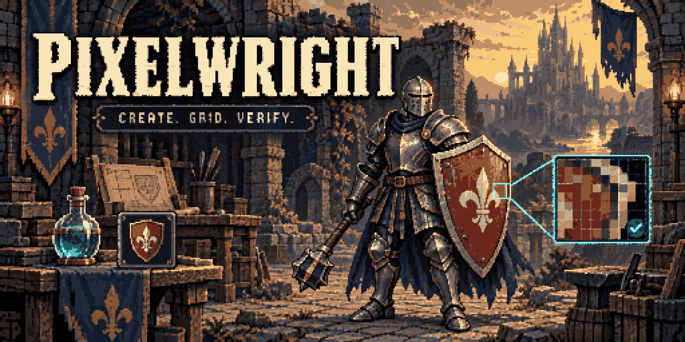
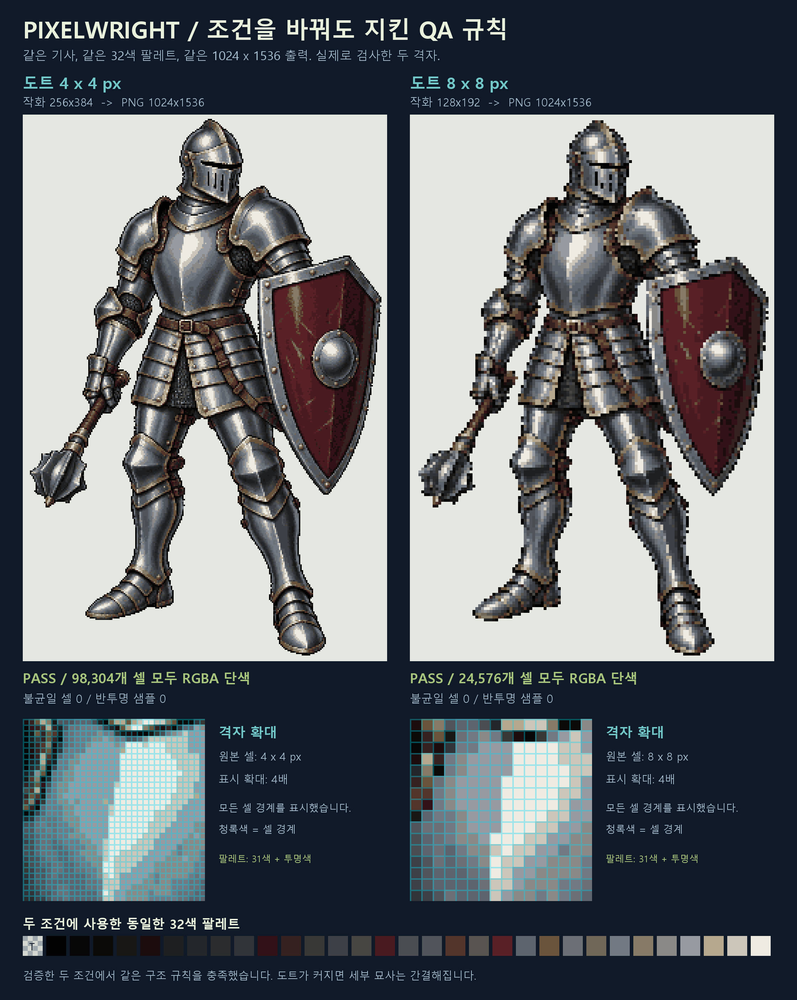
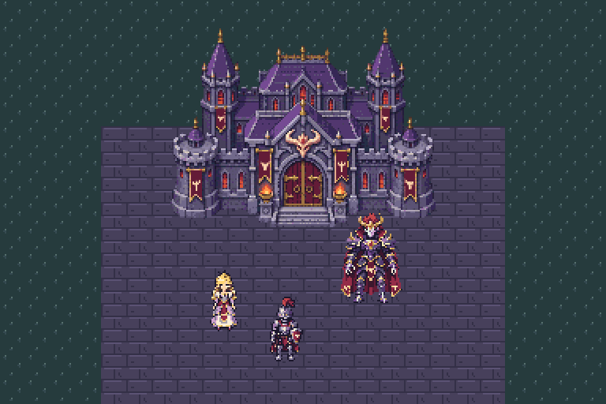
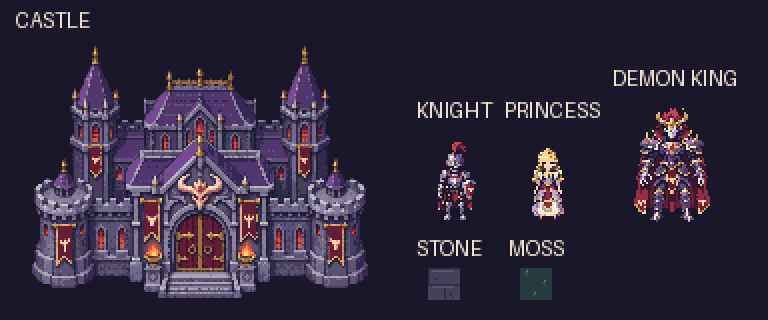
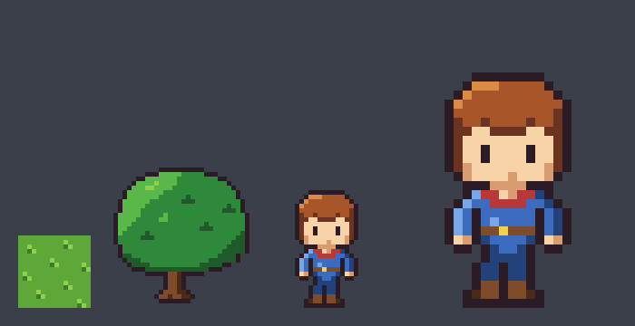
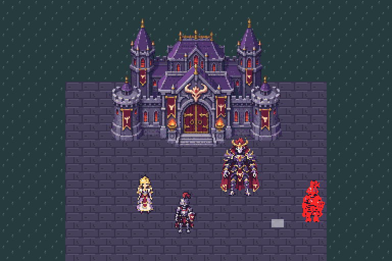

# Pixelwright



[English](README.md) · [한국어](README.ko.md) · 버전 0.7.0 · [Apache License 2.0](LICENSE)

**정적 PNG 픽셀아트의 격자·색상·투명도를 검수합니다.**

Pixelwright는 실제 이미지의 픽셀을 선언한 품질 프로필과 비교하고, JSON 판정과 시각적 검사 자료를 만듭니다. 캐릭터·아이템·UI 아이콘을 검수하거나 여러 에셋에 같은 기준을 적용할 수 있습니다. Python 도구와 함께 GPT 계열 호스트·Claude에서 사용할 수 있는 공통 AI 스킬을 제공합니다.

현재 핵심 기능은 정적 PNG 검수입니다. [게임 계약](#게임-계약-게임-전체를-하나의-픽셀-크기로)은 1× 에셋부터 실행 중인 게임 화면까지 게임 전체를 하나의 픽셀 크기와 스타일로 맞춥니다. 생성·보정·팔레트 편집·레이어·애니메이션은 [개발 중 기능](#개발-중-기능)으로 소개합니다.

## 핵심 기능: 픽셀아트 검수

| 검사 | 확인하는 내용 |
| --- | --- |
| 이미지 크기·격자 | 논리 캔버스에 동일한 정수 배율을 곱한 크기인지, 원점 `(0, 0)`에서 격자가 맞는지 확인합니다. |
| 정사각형 셀 | 선언한 셀 내부의 모든 샘플이 정확히 같은 RGBA 값인지 검사합니다. |
| 팔레트 | 실제 가시 RGB 색상 수와 선택적으로 지정한 RGBA 팔레트를 검사합니다. |
| 투명도 | 알파 정책과 완전히 투명한 픽셀의 숨은 RGB 처리 규칙을 확인합니다. |
| 검사 근거 | JSON 보고서, 원본·프로필 해시, 격자 미리보기, 전체 불균일 셀 마스크를 남깁니다. |
| 일괄 검사·CI | 여러 PNG에 같은 프로필을 적용하고 통과·검사 실패·실행 오류를 종료 코드로 구분합니다. |

검사는 입력 원본을 보존합니다. 검사 전에 의도한 격자를 선언해야 합니다. 기술적 PASS는 그 규칙의 통과를 뜻하며, 실루엣·가독성·미적 품질은 별도로 검토합니다. 입력은 RGBA8로 읽을 수 있는 정적 PNG입니다. 형식 제한과 출력물은 [품질 규격](pixelwright/references/quality-contract.md)에 정리되어 있습니다.

## 바로 시작하기

**Python 3.12 이상**, Pillow, NumPy가 필요합니다. 저장소 루트에서 실행합니다.

```sh
git clone https://github.com/arden-deq/pixelwright.git
cd pixelwright
python -m venv .venv
```

가상 환경을 활성화합니다.

```sh
# macOS / Linux
source .venv/bin/activate
```

```powershell
# Windows PowerShell
.\.venv\Scripts\Activate.ps1
```

의존성을 설치하고 동봉한 기사 PNG를 검사합니다.

```sh
python -m pip install -r pixelwright/requirements.txt
python pixelwright/scripts/pixelwright.py inspect docs/examples/knight/4px/rendered.png --profile docs/examples/knight/4px/profile.json --out-dir runs/knight-4px-audit-v1
```

이미 존재하는 **1024×1536 PNG**를 **256×384 논리 캔버스·4배 배율**, 가시 색상 31개와 투명색 조건으로 검사합니다. 이미지를 새로 생성하거나 보정하지 않습니다. 출력 폴더의 `report.json`과 `grid_overlay.png`를 원본 PNG와 함께 확인합니다. 출력 폴더는 새 폴더이거나 비어 있어야 하며, 재실행할 때는 다른 이름을 사용합니다.

## 검수 예시: 같은 기사, 두 가지 격자



두 PNG 모두 **1024×1536**이며 **투명색 포함 32개 RGBA 색상**을 사용합니다. 저장된 이미지에서 실제로 측정한 결과입니다.

| 예제 | 논리 캔버스 | 셀 크기 | 단색 셀 | 판정 |
| --- | --- | --- | ---: | --- |
| [세밀한 도트](docs/examples/knight/4px/rendered.png) | 256×384 | 4×4 px | 98,304 / 98,304 | [PASS 보고서](docs/examples/knight/4px/report.json) |
| [큰 도트](docs/examples/knight/8px/rendered.png) | 128×192 | 8×8 px | 24,576 / 24,576 | [PASS 보고서](docs/examples/knight/8px/report.json) |

두 검사 모두 불균일 셀·반투명 픽셀·지정 팔레트 밖의 샘플이 0개입니다. 별도의 [4 px](docs/examples/knight/4px/verification.json)·[8 px](docs/examples/knight/8px/verification.json) 기록에서도 작화 원본의 정확한 최근접 이웃 확대인지 확인했습니다.

[4 px 전체 격자](docs/examples/knight/4px/grid_overlay.png)와 [8 px 전체 격자](docs/examples/knight/8px/grid_overlay.png)에서 모든 셀을 볼 수 있습니다. 격자선은 별도 진단 이미지이며, 정확한 색상 측정은 원본 PNG의 보고서를 기준으로 합니다. [예제 폴더](docs/examples/knight/)에 프로필·원본·파생 이미지·검증 기록을 보존했습니다. 이 결과는 검사한 기술 규격의 통과이며, 미적 품질의 자동 승인을 뜻하지 않습니다.

## 품질 프로필 선언

의도한 규칙을 `profile.json`으로 저장합니다.

```json
{
  "schema_version": 1,
  "name": "24px game items",
  "logical_size": "24x24",
  "scale": 8,
  "max_colors": 10,
  "alpha": "binary",
  "transparent_rgb": "exact"
}
```

**192×192 PNG·8×8 px 셀**, 가시 RGB 10색 이하, 알파 0 또는 255를 요구하는 프로필입니다. 엄격한 프로필의 배율은 2 이상이어야 합니다. `transparent_rgb: "exact"`는 숨은 RGB까지 비교합니다. 알파가 0인 픽셀의 RGB를 정규화하려면 `"visible"`을 명시합니다. 선택 항목 `allowed_palette`로 전체 RGBA 값을 제한할 수 있습니다. 같은 색의 인접 셀이 모여 불규칙한 형태를 이루는 것은 허용됩니다.

한 이미지 또는 여러 이미지를 같은 프로필로 검사합니다.

```sh
python pixelwright/scripts/pixelwright.py inspect input.png --profile profile.json --out-dir runs/audit-v1
python pixelwright/scripts/pixelwright.py batch item-a.png item-b.png --profile profile.json --out-dir runs/batch-v1
```

| 종료 코드 | 의미 |
| --- | --- |
| `0` | 선언한 기술 검사 모두 PASS |
| `2` | 하나 이상의 검사 결과가 FAIL 또는 REVIEW |
| `1` | 입력·프로필·실행 오류 |

격자 크기가 맞지 않으면 셀 색상 통과 판정을 진행하지 않습니다. 상태·정확한 위반 수·미리보기를 함께 확인합니다. 단일 검사에는 `report.json`과 격자 진단 이미지가, 일괄 검사에는 `batch.json`과 번호별 출력 폴더가 생성됩니다. 출력물별 설명은 [품질 규격](pixelwright/references/quality-contract.md)에 있습니다.

## 게임 계약: 게임 전체를 하나의 픽셀 크기로

0.7.0에서 추가했습니다. 프로필은 PNG 한 장을 검사하고, **게임 계약**(`game.json`)은 한 게임의 모든 에셋과 화면이 공유할 기준을 정합니다. 여러 사람이나 AI가 만든 그림도 이 기준으로 일관성을 유지합니다.

<picture>
  <source media="(max-width: 1279px)" srcset="docs/examples/demon-castle/scene-native.png">
  
</picture>

[확대용 PNG: 2304×1536, 6배](docs/images/game-scene-6x.png). 넓은 화면에서는 2배, 좁은 화면에서는 1배 미리보기를 사용합니다. 모두 같은 논리 원본을 최근접 정수 배율로 내보낸 파일입니다.

예제는 기사·공주·마왕이 마왕성 앞뜰에 있는 **RPG Maker풍 필드 맵**입니다. 독립 에셋 6개를 384×256 캔버스에 합성하고 실제 브라우저 캡처와 대조했습니다. 타일은 16×16, 인간 캐릭터는 32×48, 보스는 64×64, 성은 192×128입니다. 게임에 넣는 1× PNG 6개 모두 64색과 투명색을 공유하고 같은 기술 계약 검사를 통과합니다.

성과 캐릭터 3종은 이미지 생성으로 각각 제작한 뒤, 선언한 논리 격자와 공통 팔레트에 맞춘 파생 에셋으로 내보냈습니다. 바닥 2종은 인덱스 픽셀로 제작했습니다. [생성 원본·프롬프트·원본과 파생 에셋의 개별 검사 기록](docs/examples/demon-castle/)을 함께 제공합니다.

<picture>
  <source media="(max-width: 1279px)" srcset="docs/images/game-assets-native.png">
  
</picture>

[브라우저 시각 검수](docs/examples/demon-castle/quality-review/README.md)에서는 바닥과 생성 오브젝트의 디테일 밀도 차이, 작은 캐릭터의 얼굴 표현 손실, 마왕의 고립 픽셀을 확인했습니다. 기술 PASS가 미술 품질의 균일함을 뜻하지 않으며, 에셋의 미술적 개선은 더 필요합니다.

저장소 루트에서 `python -m http.server 8000`을 실행하고 [필드 데모](http://localhost:8000/pixelwright/examples/demon-castle/)를 열면 됩니다. 방향키로 기사를 움직이고 **R**로 초기화, **F**로 전체 화면을 전환합니다. [브라우저 검증 기록](docs/examples/demon-castle/runtime-verification.json)은 에셋 로딩·이동·충돌·앞뒤 가림·정수 배율을 확인합니다. 정상 실행 스크린샷은 [게임 화면 검사도 통과](docs/examples/demon-castle/runtime-clean-report.json)합니다.

계약에는 다음을 담습니다.

- **화면:** 기본 해상도 하나(예제는 384×256). 정수 배율로만 키우고, 남는 창 공간은 여백 색으로 채웁니다.
- **픽셀 크기:** 스프라이트, 타일, 이펙트, UI, 폰트를 모두 1×로 그립니다. 이미지 픽셀 하나가 게임 픽셀 하나입니다.
- **색과 크기:** 팔레트와 명암 단계, 색 수, 투명도, 에셋 종류별 크기 범위(맵칩·지형은 외곽선 규칙에서 뺄 수 있음)
- **스타일:** 시점, 광원 방향, 음영, 외곽선 방식과 색, 디더링, 안티앨리어싱, 분위기, 기준 에셋
- **실행:** 폰트 크기, 애니메이션 속도, 회전 방식, 이펙트 혼합, 엔진

`brief`는 이 계약을 그리기 전에 따를 규칙으로 바꿔 줍니다. 그림을 그리는 사람, AI, 이미지 생성 프롬프트가 같은 규칙을 씁니다. 모든 항목을 채운 [예제 게임](pixelwright/examples/demon-castle/)이 들어 있습니다.

```sh
python pixelwright/scripts/pixel_game.py brief --contract pixelwright/examples/demon-castle/game.json
python pixelwright/scripts/pixel_game.py asset pixelwright/examples/demon-castle/build/knight.png --category character --contract pixelwright/examples/demon-castle/game.json --out-dir runs/knight-v1
python pixelwright/scripts/pixel_game.py intake new_enemy.png --category character --contract pixelwright/examples/demon-castle/game.json --out-dir runs/intake-v1
python pixelwright/scripts/pixel_game.py screen capture.png --contract pixelwright/examples/demon-castle/game.json --out-dir runs/screen-v1
```

**에셋을 추가하기 전에** `intake`가 새 에셋을 게임의 기준 에셋 옆에 1×로 놓고, 그 줄 전체를 같은 정수 배율로 키웁니다. 아래는 석재 타일·성·기사·공주·마왕 옆에 기사를 2배로 내보낸 파일을 놓은 결과입니다. 점 크기가 2×2로 측정되어 `COARSE_PIXELS`, `PIXEL_SIZE_DIFFERS`, `CATEGORY_SIZE`로 실패합니다.



**실행 중인 게임에서는** `screen`이 무손실 스크린샷을 기본 해상도 격자로 검사합니다. 데모의 `?fault=1` 모드는 오류 검출을 보여 주기 위해 두 번째 기사를 격자에서 화면 픽셀 2개만큼 어긋나게 그리고, 투명도 50% 이펙트를 추가합니다. 이 실제 브라우저 캡처는 1664×1088 창에서 4배로 표시한 화면입니다. 검사기가 **불균일한 게임 픽셀 453개**(빨강)와 **팔레트 밖 픽셀 96개**(자홍)를 검출합니다. [실패 검사 기록](docs/examples/demon-castle/runtime-injected-errors-report.json)을 함께 제공합니다.

<picture>
  <source media="(max-width: 1279px)" srcset="docs/images/game-screen-check-native.png">
  
</picture>

[검사기 원본 오버레이](docs/images/game-screen-check.png).

| 게임에서 잘못된 것 | 코드 |
| --- | --- |
| 확대해서 내보내거나 한 방향으로 늘린 에셋 | `COARSE_PIXELS` |
| 에셋 일부, 또는 화면 안의 스프라이트·폰트·UI를 2배 이상으로 그림 | `COARSE_REGION` (검토) |
| 소수점 좌표·카메라, 실행 중 회전, 선형 필터, 밉맵, 비정수 배율 | `CELL_NOT_UNIFORM` |
| 반투명·가산 이펙트, 틴트, 색 보정 | `COLOR_OUTSIDE_PALETTE` |
| 여백 색이 아닌 여백 | `LETTERBOX_NOT_UNIFORM` |
| 스타일과 다른 색·투명도·종류별 크기·디더링·외곽선 | `COLOR_OUTSIDE_PALETTE`, `PARTIAL_ALPHA`, `CATEGORY_SIZE`, `DITHERING_FOUND`, `OUTLINE_*` |

`viewport`는 창 크기별 정수 배율과 여백을 알려 줍니다. 항목과 코드 전체는 [게임 계약 문서](pixelwright/references/game.md)에 있고, Unity·Godot 4·Phaser 3·PixiJS·웹 캔버스·LÖVE·GameMaker 설정은 [엔진 설정](pixelwright/references/engines.md)에 있습니다. 점 크기는 색 경계로 측정하므로, 경계가 적은 단순한 1× 그림은 실패가 아니라 검토로 보고합니다. 광원, 음영의 질, 분위기는 측정하지 않으니 나란히 놓은 비교 그림을 보고 판단합니다.

## AI 스킬로 사용하기

스크립트·참조 문서·예제를 포함한 **`pixelwright/` 폴더 전체**를 설치합니다.

| 호스트 | 개인 스킬 경로 | 호출 |
| --- | --- | --- |
| Codex | `~/.agents/skills/pixelwright/` | `$pixelwright` |
| Claude Code | `~/.claude/skills/pixelwright/` | `/pixelwright` |

호스트에서 원본 PNG에 접근하고, 의존성을 설치한 Python을 실행할 수 있어야 합니다. 스킬을 불러온 뒤 다음과 같이 요청할 수 있습니다.

> 이 PNG를 24×24 논리 픽셀·8배 배율, 가시 색상 10개 이하, 이진 투명도로 검사해 줘. 원본과 격자 미리보기, 실제 PASS/FAIL 보고서를 보여 줘.

게임이라면 스타일부터 정합니다.

> 384×256 RPG Maker풍 필드야. 타일은 16×16, 캐릭터는 32×48, 보스는 64×64, 외곽선은 선택적으로 넣는 어두운 1픽셀이야. 마왕성 예제의 공통 팔레트와 기준 에셋을 써 줘. 브리프를 보여 준 다음, 새 1× 적을 기사·공주·마왕 옆에 놓고 검사해 줘.

원본 파일과 성공한 검사 실행이 없으면 **미검증**입니다. 설치와 실행 조건은 [SKILL.md](pixelwright/SKILL.md)와 [플랫폼 호환성 안내](docs/COMPATIBILITY_ko.md)를 참고합니다.

## 개발 중 기능

다음 기능은 현재 개발 중입니다. README에는 개요만 소개하며, 아직 `main`에 없는 문서는 `codex/design-first-sprites` 개발 브랜치로 연결합니다.

| 기능 | 개발 방향 | 상세 |
| --- | --- | --- |
| 픽셀아트 생성·격자 보정 | 논리 캔버스 렌더링과 재검사가 필요한 파생 보정 후보 생성 | [생성](pixelwright/references/creation.md) · [보정](pixelwright/references/quality-contract.md#artifacts-and-coordinates) |
| 팔레트 편집 | 팔레트 재사용·추출·명암 램프·색상 변환 | [팔레트](pixelwright/references/palettes.md) |
| 레이어 합성 | 공통 격자로 합성하고 레이어별·최종 결과를 검사 | [레이어](pixelwright/references/layers.md) |
| 외부 스프라이트 시트 검증 | sprite-gen PNG·manifest의 팔레트·여백·외곽 크기 일관성 검사 | [시트 규격](https://github.com/arden-deq/pixelwright/blob/codex/design-first-sprites/pixelwright/references/external-atlases.md) · [검증 기록](https://github.com/arden-deq/pixelwright/blob/codex/design-first-sprites/docs/VALIDATION_external_atlases_ko.md) |
| 애니메이션·동작 검증 | 선택한 2D 시안·관찰 부위·프레임 일관성·선택적 3D 자세 가이드 | [2D 경로](https://github.com/arden-deq/pixelwright/blob/codex/design-first-sprites/docs/SPRITE_2D_ko.md) · [3D 경로](docs/SPRITE_3D_ko.md) · [진행 상황](https://github.com/arden-deq/pixelwright/blob/codex/design-first-sprites/docs/SPRITE_REQUIREMENTS_AND_STATUS_ko.md) |

시트 연동은 [sprite-gen](https://github.com/aldegad/sprite-gen)의 출력 규격을 따릅니다. [개발 브랜치의 패키지 출처 선언](https://github.com/arden-deq/pixelwright/blob/codex/design-first-sprites/pixelwright/upstream-integrations.json)에 원본 저장소·라이선스·확인한 버전/커밋, `data_format` 관계와 `runtime_required: false`를 기록합니다. 개발 기능의 구현이 생성 작화의 완성도나 자연스러운 움직임의 승인을 뜻하지는 않습니다. 시트·2D 동작 관련 구현은 개발 브랜치에서 진행하며, v0.7.0 배포 파일에는 `main`에 있는 기능만 들어 있습니다.

## 검증과 패키징

```sh
python -m unittest discover -s pixelwright/tests -v
python tools/package_skill.py --out-dir dist
python tools/package_skill.py --verify dist/pixelwright-v0.7.0.zip
```

패키징은 설치 ZIP과 개발 키트 ZIP을 만듭니다. 패키지 검증기는 ZIP 구조와 SHA-256 목록을 검사합니다. 이번 릴리스는 [v0.7.0 검증 기록](docs/VALIDATION_v070_ko.md)에, 정사각형 격자 진단은 [이전 검증 기록](docs/VALIDATION_v051_ko.md)에 있습니다. 이 밖에 구현 근거를 담은 [설계 문서](docs/DESIGN_ko.md)도 확인할 수 있습니다.

## 라이선스와 보안

Pixelwright에는 **Apache License 2.0**을 적용합니다. [LICENSE](LICENSE), [NOTICE](NOTICE), [SECURITY.md](SECURITY.md)를 확인합니다. 저장소에는 [CI](.github/workflows/ci.yml), [CodeQL](.github/workflows/codeql.yml), [의존성 업데이트 설정](.github/dependabot.yml)이 포함됩니다.
