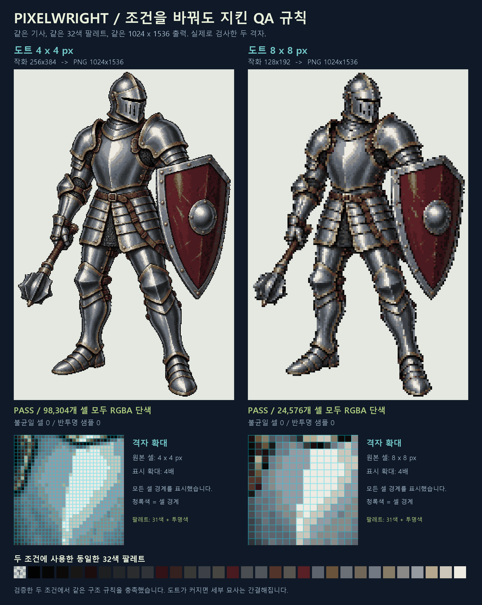

# Pixelwright


[English](README.md) · [한국어](README.ko.md) · 버전 0.6.2 · [Apache License 2.0](LICENSE)

**정적 PNG 픽셀아트의 격자·색상·투명도를 검수합니다.**

Pixelwright는 실제 이미지의 픽셀을 선언한 품질 프로필과 비교하고, JSON 판정과 시각적 검사 자료를 만듭니다. 캐릭터·아이템·UI 아이콘을 검수하거나 여러 에셋에 같은 기준을 적용할 수 있습니다. Python 도구와 함께 GPT 계열 호스트·Claude에서 사용할 수 있는 공통 AI 스킬을 제공합니다.

현재 핵심 기능은 정적 PNG 검수입니다. 생성·보정·팔레트 편집·레이어·애니메이션은 [개발 중 기능](#개발-중-기능)으로 소개합니다.

## 핵심 기능: 픽셀아트 검수

| 검사 | 확인하는 내용 |
| --- | --- |
| 이미지 크기·격자 | 논리 캔버스에 동일한 정수 배율을 곱한 크기인지, 원점 `(0, 0)`에서 격자가 맞는지 확인합니다. |
| 정사각형 셀 | 선언한 셀 내부의 모든 샘플이 정확히 같은 RGBA 값인지 검사합니다. |
| 팔레트 | 실제 가시 RGB 색상 수와 선택적으로 지정한 RGBA 팔레트를 검사합니다. |
| 투명도 | 알파 정책과 완전히 투명한 픽셀의 숨은 RGB 처리 규칙을 확인합니다. |
| 검사 근거 | JSON 보고서, 원본·프로필 해시, 격자 미리보기, 전체 불균일 셀 마스크를 남깁니다. |
| 일괄 검사·CI | 여러 PNG에 같은 프로필을 적용하고 통과·검사 실패·실행 오류를 종료 코드로 구분합니다. |

검사는 입력 원본을 보존합니다. 검사 전에 의도한 격자를 선언해야 합니다. 기술적 PASS는 그 규칙의 통과를 뜻하며, 실루엣·가독성·미적 품질은 별도로 검토합니다. 입력은 RGBA8로 읽을 수 있는 정적 PNG입니다. 형식 제한과 출력물은 [품질 규격](pixelwright/references/quality-contract.md)에 정리되어 있습니다.

## 바로 시작하기

**Python 3.12 이상**, Pillow, NumPy가 필요합니다. 저장소 루트에서 실행합니다.

```sh
git clone https://github.com/arden-deq/pixelwright.git
cd pixelwright
python -m venv .venv
```

가상 환경을 활성화합니다.

```sh
# macOS / Linux
source .venv/bin/activate
```

```powershell
# Windows PowerShell
.\.venv\Scripts\Activate.ps1
```

의존성을 설치하고 동봉한 기사 PNG를 검사합니다.

```sh
python -m pip install -r pixelwright/requirements.txt
python pixelwright/scripts/pixelwright.py inspect docs/examples/knight/4px/rendered.png --profile docs/examples/knight/4px/profile.json --out-dir runs/knight-4px-audit-v1
```

이미 존재하는 **1024×1536 PNG**를 **256×384 논리 캔버스·4배 배율**, 가시 색상 31개와 투명색 조건으로 검사합니다. 이미지를 새로 생성하거나 보정하지 않습니다. 출력 폴더의 `report.json`과 `grid_overlay.png`를 원본 PNG와 함께 확인합니다. 출력 폴더는 새 폴더이거나 비어 있어야 하며, 재실행할 때는 다른 이름을 사용합니다.

## 검수 예시: 같은 기사, 두 가지 격자



두 PNG 모두 **1024×1536**이며 **투명색 포함 32개 RGBA 색상**을 사용합니다. 저장된 이미지에서 실제로 측정한 결과입니다.

| 예제 | 논리 캔버스 | 셀 크기 | 단색 셀 | 판정 |
| --- | --- | --- | ---: | --- |
| [세밀한 도트](docs/examples/knight/4px/rendered.png) | 256×384 | 4×4 px | 98,304 / 98,304 | [PASS 보고서](docs/examples/knight/4px/report.json) |
| [큰 도트](docs/examples/knight/8px/rendered.png) | 128×192 | 8×8 px | 24,576 / 24,576 | [PASS 보고서](docs/examples/knight/8px/report.json) |

두 검사 모두 불균일 셀·반투명 픽셀·지정 팔레트 밖의 샘플이 0개입니다. 별도의 [4 px](docs/examples/knight/4px/verification.json)·[8 px](docs/examples/knight/8px/verification.json) 기록에서도 작화 원본의 정확한 최근접 이웃 확대인지 확인했습니다.

[4 px 전체 격자](docs/examples/knight/4px/grid_overlay.png)와 [8 px 전체 격자](docs/examples/knight/8px/grid_overlay.png)에서 모든 셀을 볼 수 있습니다. 격자선은 별도 진단 이미지이며, 정확한 색상 측정은 원본 PNG의 보고서를 기준으로 합니다. [예제 폴더](docs/examples/knight/)에 프로필·원본·파생 이미지·검증 기록을 보존했습니다. 이 결과는 검사한 기술 규격의 통과이며, 미적 품질의 자동 승인을 뜻하지 않습니다.

## 품질 프로필 선언

의도한 규칙을 `profile.json`으로 저장합니다.

```json
{
  "schema_version": 1,
  "name": "24px game items",
  "logical_size": "24x24",
  "scale": 8,
  "max_colors": 10,
  "alpha": "binary",
  "transparent_rgb": "exact"
}
```

**192×192 PNG·8×8 px 셀**, 가시 RGB 10색 이하, 알파 0 또는 255를 요구하는 프로필입니다. 엄격한 프로필의 배율은 2 이상이어야 합니다. `transparent_rgb: "exact"`는 숨은 RGB까지 비교합니다. 알파가 0인 픽셀의 RGB를 정규화하려면 `"visible"`을 명시합니다. 선택 항목 `allowed_palette`로 전체 RGBA 값을 제한할 수 있습니다. 같은 색의 인접 셀이 모여 불규칙한 형태를 이루는 것은 허용됩니다.

한 이미지 또는 여러 이미지를 같은 프로필로 검사합니다.

```sh
python pixelwright/scripts/pixelwright.py inspect input.png --profile profile.json --out-dir runs/audit-v1
python pixelwright/scripts/pixelwright.py batch item-a.png item-b.png --profile profile.json --out-dir runs/batch-v1
```

| 종료 코드 | 의미 |
| --- | --- |
| `0` | 선언한 기술 검사 모두 PASS |
| `2` | 하나 이상의 검사 결과가 FAIL 또는 REVIEW |
| `1` | 입력·프로필·실행 오류 |

격자 크기가 맞지 않으면 셀 색상 통과 판정을 진행하지 않습니다. 상태·정확한 위반 수·미리보기를 함께 확인합니다. 단일 검사에는 `report.json`과 격자 진단 이미지가, 일괄 검사에는 `batch.json`과 번호별 출력 폴더가 생성됩니다. 출력물별 설명은 [품질 규격](pixelwright/references/quality-contract.md)에 있습니다.

## AI 스킬로 사용하기

스크립트·참조 문서·예제를 포함한 **`pixelwright/` 폴더 전체**를 설치합니다.

| 호스트 | 개인 스킬 경로 | 호출 |
| --- | --- | --- |
| Codex | `~/.agents/skills/pixelwright/` | `$pixelwright` |
| Claude Code | `~/.claude/skills/pixelwright/` | `/pixelwright` |

호스트에서 원본 PNG에 접근하고, 의존성을 설치한 Python을 실행할 수 있어야 합니다. 스킬을 불러온 뒤 다음과 같이 요청할 수 있습니다.

> 이 PNG를 24×24 논리 픽셀·8배 배율, 가시 색상 10개 이하, 이진 투명도로 검사해 줘. 원본과 격자 미리보기, 실제 PASS/FAIL 보고서를 보여 줘.

원본 파일과 성공한 검사 실행이 없으면 **미검증**입니다. 설치와 실행 조건은 [SKILL.md](pixelwright/SKILL.md)와 [플랫폼 호환성 안내](docs/COMPATIBILITY_ko.md)를 참고합니다.

## 개발 중 기능

다음 기능은 현재 개발 중입니다. README에는 개요만 소개하며, 구현 내용·실험·제약은 각 문서에서 확인할 수 있습니다.

| 기능 | 개발 방향 | 상세 |
| --- | --- | --- |
| 픽셀아트 생성·격자 보정 | 논리 캔버스 렌더링과 재검사가 필요한 파생 보정 후보 생성 | [생성](pixelwright/references/creation.md) · [보정](pixelwright/references/quality-contract.md#artifacts-and-coordinates) |
| 팔레트 편집 | 팔레트 재사용·추출·명암 램프·색상 변환 | [팔레트](pixelwright/references/palettes.md) |
| 레이어 합성 | 공통 격자로 합성하고 레이어별·최종 결과를 검사 | [레이어](pixelwright/references/layers.md) |
| 외부 스프라이트 시트 검증 | sprite-gen PNG·manifest의 팔레트·여백·외곽 크기 일관성 검사 | [시트 규격](pixelwright/references/external-atlases.md) · [검증 기록](docs/VALIDATION_external_atlases_ko.md) |
| 애니메이션·동작 검증 | 선택한 2D 시안·관찰 부위·프레임 일관성·선택적 3D 자세 가이드 | [2D 경로](docs/SPRITE_2D_ko.md) · [3D 경로](docs/SPRITE_3D_ko.md) · [진행 상황](docs/SPRITE_REQUIREMENTS_AND_STATUS_ko.md) |

시트 연동은 [sprite-gen](https://github.com/aldegad/sprite-gen)의 출력 규격을 따릅니다. [패키지 출처 선언](pixelwright/upstream-integrations.json)에 원본 저장소·라이선스·확인한 버전/커밋, `data_format` 관계와 `runtime_required: false`를 기록합니다. 개발 기능의 구현이 생성 작화의 완성도나 자연스러운 움직임의 승인을 뜻하지는 않습니다. 기존 v0.6.2 배포 파일은 그대로이며, 현재 소스에서 빌드한 패키지에는 개발 도구가 포함될 수 있습니다.

## 검증과 패키징

```sh
python -m unittest discover -s pixelwright/tests -v
python tools/package_skill.py --out-dir dist
python tools/package_skill.py --verify dist/pixelwright-v0.6.2.zip
```

패키징은 설치 ZIP과 개발 키트 ZIP을 만듭니다. 패키지 검증기는 ZIP 구조와 SHA-256 목록을 검사합니다. 정사각형 격자 진단의 [검증 기록](docs/VALIDATION_v051_ko.md)과 구현 근거를 담은 [설계 문서](docs/DESIGN_ko.md)도 확인할 수 있습니다.

## 라이선스와 보안

Pixelwright에는 **Apache License 2.0**을 적용합니다. [LICENSE](LICENSE), [NOTICE](NOTICE), [SECURITY.md](SECURITY.md)를 확인합니다. 저장소에는 [CI](.github/workflows/ci.yml), [CodeQL](.github/workflows/codeql.yml), [의존성 업데이트 설정](.github/dependabot.yml)이 포함됩니다.
