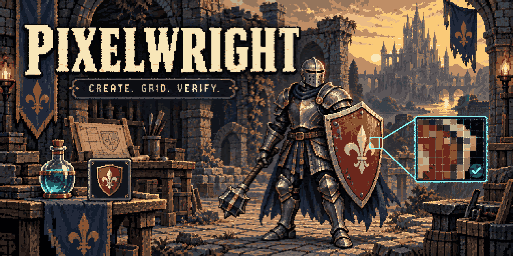
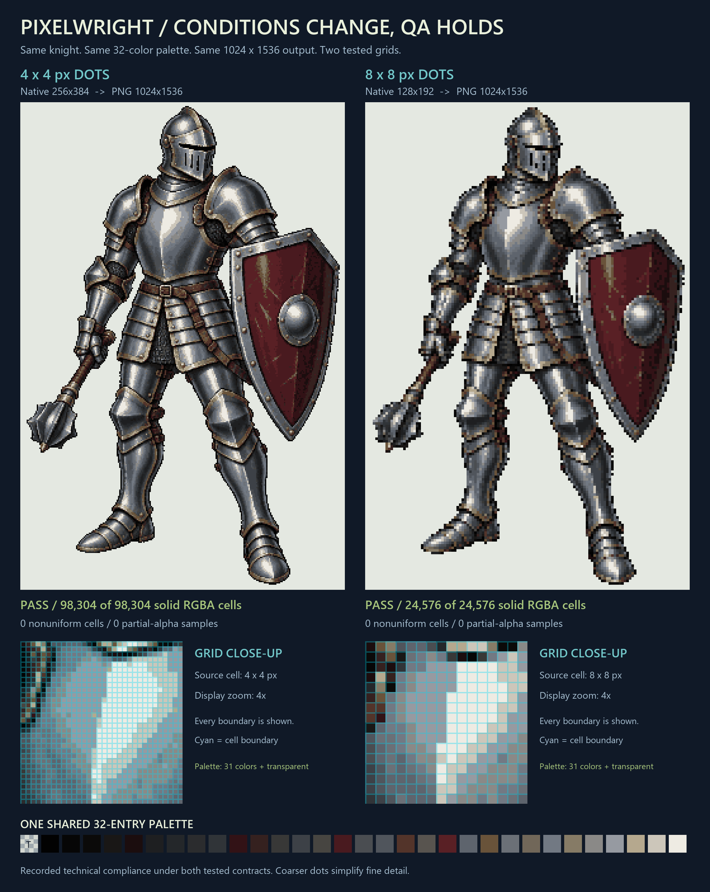

# Pixelwright



[English](README.md) · [한국어](README.ko.md) · Version 0.6.2 · [Apache License 2.0](LICENSE)

**Audit the grid, colors, and transparency of static PNG pixel art.**

Pixelwright checks actual image pixels against a declared quality profile and produces a JSON verdict and visual diagnostics. Use it to review characters, items, and UI icons, or to apply the same acceptance rules to a batch of assets. Its Python tools also work through the shared AI skill for GPT-powered hosts and Claude.

Static PNG inspection is the main feature. Generation, repair, palette editing, layers, and animation workflows are currently presented as [features in development](#features-in-development).

## Main feature: pixel-art inspection

| Check | What it verifies |
| --- | --- |
| Dimensions and grid | The PNG matches the logical canvas multiplied by one integer scale on both axes, with the origin at `(0, 0)`. |
| Square cells | Every sample within each declared cell has exactly the same RGBA value. |
| Palette | The actual visible RGB count stays within the budget; an optional palette constrains exact RGBA values. |
| Transparency | Alpha follows the declared policy, including how hidden RGB under transparent pixels is handled. |
| Evidence | A JSON report, source/profile hashes, grid previews, and complete invalid-cell masks record the result. |
| Batch and CI | Multiple PNGs share one profile, with exit codes for acceptance, QA failures, and execution errors. |

Inspection preserves the input. Declare the intended grid before checking it. A technical PASS applies to those rules; silhouette, readability, and artistic quality still need visual review. Input must be a static PNG decodable into RGBA8. See the [full quality contract](pixelwright/references/quality-contract.md) for format limits and output details.

## Quick start

Requires **Python 3.12+**, Pillow, and NumPy. Run from the repository root:

```sh
git clone https://github.com/arden-deq/pixelwright.git
cd pixelwright
python -m venv .venv
```

Activate the environment:

```sh
# macOS / Linux
source .venv/bin/activate
```

```powershell
# Windows PowerShell
.\.venv\Scripts\Activate.ps1
```

Install the dependencies and inspect the included knight PNG:

```sh
python -m pip install -r pixelwright/requirements.txt
python pixelwright/scripts/pixelwright.py inspect docs/examples/knight/4px/rendered.png --profile docs/examples/knight/4px/profile.json --out-dir runs/knight-4px-audit-v1
```

This checks an existing **1024×1536 PNG** against a **256×384 logical canvas at 4× scale**, with 31 visible colors plus transparency. It does not generate or repair an image. Open `report.json` and `grid_overlay.png` in the output directory alongside the input PNG. Output directories must be new or empty; use a different name for each run.

## Inspection example: one knight, two grids



Both PNGs are **1024×1536** and use the same **32 RGBA colors including transparency**. These are measured results from the saved images:

| Example | Logical canvas | Cell size | Uniform cells | Result |
| --- | --- | --- | ---: | --- |
| [Fine dots](docs/examples/knight/4px/rendered.png) | 256×384 | 4×4 px | 98,304 / 98,304 | [PASS report](docs/examples/knight/4px/report.json) |
| [Larger dots](docs/examples/knight/8px/rendered.png) | 128×192 | 8×8 px | 24,576 / 24,576 | [PASS report](docs/examples/knight/8px/report.json) |

Both inspections found zero nonuniform cells, partially transparent pixels, or samples outside the declared palette. Independent [4 px](docs/examples/knight/4px/verification.json) and [8 px](docs/examples/knight/8px/verification.json) records also confirm exact nearest-neighbor enlargement of the native images.

View the complete [4 px grid](docs/examples/knight/4px/grid_overlay.png) or [8 px grid](docs/examples/knight/8px/grid_overlay.png). Grid lines are separate diagnostic overlays; use the underlying PNG's report for exact color measurements. The [example files](docs/examples/knight/) preserve the profiles, source/derived images, and verification records. These results certify the inspected technical constraints, not automatic artistic acceptance.

## Declare a quality profile

Save the intended rules as `profile.json`:

```json
{
  "schema_version": 1,
  "name": "24px game items",
  "logical_size": "24x24",
  "scale": 8,
  "max_colors": 10,
  "alpha": "binary",
  "transparent_rgb": "exact"
}
```

This requires a **192×192 PNG with 8×8 px cells**, at most 10 visible RGB colors, and alpha values of 0 or 255. Strict profiles require a scale of at least 2. `transparent_rgb: "exact"` checks hidden RGB too; choose `"visible"` explicitly to normalize alpha-zero RGB during inspection. Optional `allowed_palette` restricts complete RGBA values. Adjacent cells can share a color and form irregular shapes.

Inspect one image or a batch under the same profile:

```sh
python pixelwright/scripts/pixelwright.py inspect input.png --profile profile.json --out-dir runs/audit-v1
python pixelwright/scripts/pixelwright.py batch item-a.png item-b.png --profile profile.json --out-dir runs/batch-v1
```

| Exit code | Meaning |
| --- | --- |
| `0` | All declared technical checks PASS. |
| `2` | At least one QA result is FAIL or REVIEW. |
| `1` | An input, profile, or execution error occurred. |

Geometry failures stop cell-color acceptance. Inspect the status, exact violation counts, and previews together. Each single-image audit writes `report.json` and grid diagnostics; a batch adds `batch.json` and separate numbered directories. Full artifact descriptions are in the [quality contract](pixelwright/references/quality-contract.md).

## Use as an AI skill

Install the **entire `pixelwright/` folder**, including scripts, references, and examples:

| Host | Personal skill directory | Invocation |
| --- | --- | --- |
| Codex | `~/.agents/skills/pixelwright/` | `$pixelwright` |
| Claude Code | `~/.claude/skills/pixelwright/` | `/pixelwright` |

The host needs access to the original PNG and a Python environment with the dependencies installed. After loading the skill, a review request can be:

> Inspect this PNG as 24×24 logical pixels at 8× scale, with at most 10 visible colors and binary transparency. Show the original, grid overlay, and actual PASS/FAIL report.

Without the original file and a successful checker run, the result remains **unverified**. See [SKILL.md](pixelwright/SKILL.md) and the [platform compatibility guide](docs/COMPATIBILITY_ko.md) for installation and execution details.

## Features in development

The following workflows remain in development. This README introduces them briefly; documents not yet on `main` link to the `codex/design-first-sprites` development branch.

| Feature | Development focus | Details |
| --- | --- | --- |
| Pixel-art generation and grid repair | Logical-canvas rendering and derived correction candidates that require reinspection. | [Creation](pixelwright/references/creation.md) · [Repair](pixelwright/references/quality-contract.md#artifacts-and-coordinates) |
| Palette editing | Reusable palettes, extraction, shading ramps, and remapping. | [Palettes](pixelwright/references/palettes.md) |
| Layer composition | Shared-grid composition with per-layer and final checks. | [Layers](pixelwright/references/layers.md) |
| External sprite-sheet validation | Palette, margin, and silhouette-size checks from sprite-gen PNGs and manifests. | [Atlas contract](https://github.com/arden-deq/pixelwright/blob/codex/design-first-sprites/pixelwright/references/external-atlases.md) · [Validation record](https://github.com/arden-deq/pixelwright/blob/codex/design-first-sprites/docs/VALIDATION_external_atlases_ko.md) |
| Animation and motion validation | Selected 2D designs, observed parts, frame consistency, and optional 3D pose guides. | [2D workflow](https://github.com/arden-deq/pixelwright/blob/codex/design-first-sprites/docs/SPRITE_2D_ko.md) · [3D workflow](docs/SPRITE_3D_ko.md) · [Progress](https://github.com/arden-deq/pixelwright/blob/codex/design-first-sprites/docs/SPRITE_REQUIREMENTS_AND_STATUS_ko.md) |

The sprite-sheet integration follows [sprite-gen](https://github.com/aldegad/sprite-gen)'s output contract. The [upstream declaration on the development branch](https://github.com/arden-deq/pixelwright/blob/codex/design-first-sprites/pixelwright/upstream-integrations.json) records its repository, license, tested version/commit, and `data_format` relationship with `runtime_required: false`. These development features do not imply production acceptance of generated artwork or natural motion. The sprite-sheet and 2D motion work is tracked on the development branch. Published v0.6.2 archives remain unchanged.

## Validation and packaging

```sh
python -m unittest discover -s pixelwright/tests -v
python tools/package_skill.py --out-dir dist
python tools/package_skill.py --verify dist/pixelwright-v0.6.2.zip
```

Packaging produces an installation ZIP and a development-kit ZIP. The package verifier checks archive layout and SHA-256 coverage. The [validation records](docs/VALIDATION_v051_ko.md) document square-grid diagnostics; the [design notes](docs/DESIGN_ko.md) explain the implementation.

## License and security

Pixelwright is licensed under **Apache License 2.0**. See [LICENSE](LICENSE), [NOTICE](NOTICE), and [SECURITY.md](SECURITY.md). The repository includes [CI](.github/workflows/ci.yml), [CodeQL](.github/workflows/codeql.yml), and [dependency update configuration](.github/dependabot.yml).
