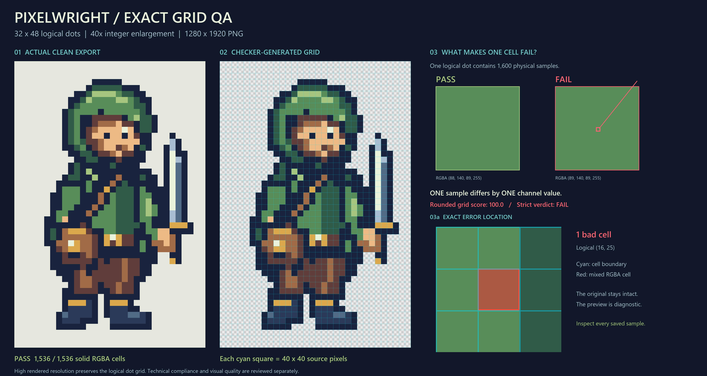
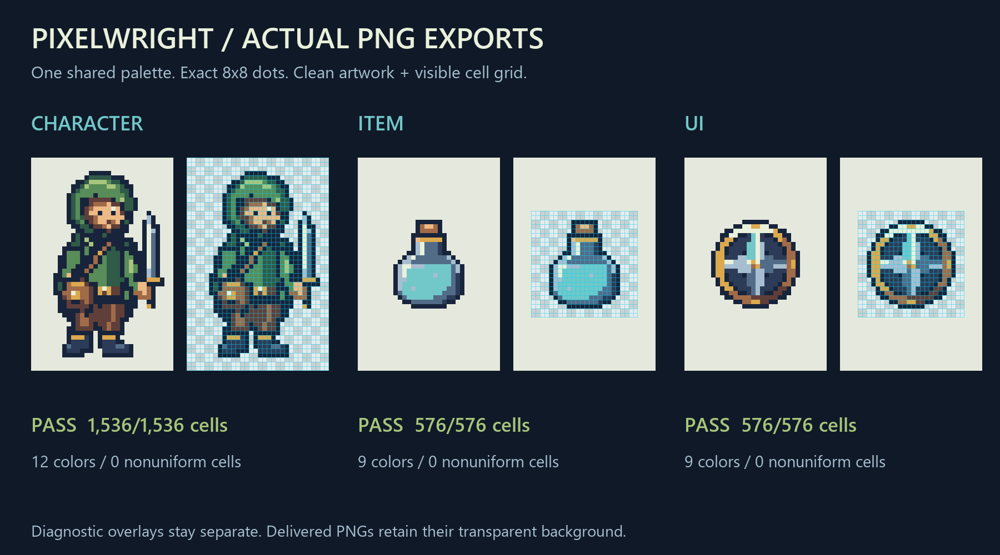

# Pixelwright

[English](README.md) · [한국어](README.ko.md) · Version 0.3.0 · [Apache License 2.0](LICENSE)

**Create static PNG pixel art on a declared grid, then verify every cell.**

Pixelwright is a shared AI skill for GPT-powered hosts and Claude. It helps create and audit characters, items, and UI icons with a consistent dot size, complete square grid cells, and exactly one RGBA color per cell. The same `SKILL.md` and Python tools serve both ecosystems; the host must provide file access and Python execution.

Author a palette and a logical pixel matrix, render at an integer scale, and audit the exported PNG. For existing artwork, declare its intended grid before inspection. By default, deliver both the clean artwork and its actual grid QA preview so users can check the cells themselves.

## See how grid QA works



This high-resolution example has a **32×48 logical grid**, enlarged **40×** to **1280×1920 PNG pixels**. Each logical dot occupies one **40×40 square cell**. High rendered resolution preserves the original 32×48 design; it does not add logical detail.

- **PASS:** every decoded RGBA sample within every cell is identical.
- **FAIL:** changing even one channel of one image sample inside a cell makes that cell nonuniform. An average diagnostic score can round to 100 while the strict verdict remains FAIL.
- **Cyan lines** mark intended cell boundaries; **red cells** mark exact color violations. **Orange reference lines** indicate invalid geometry, where cell-color acceptance cannot be determined.

The overlay is a separate diagnostic image. Its tinted colors do not change the clean PNG or supply the exact-color verdict; the checker reads the original file. Dense overlays may sample reference lines for readability while the audit still checks every cell.

Inspect the actual example files: [clean PNG](docs/examples/grid-qa/clean.png), [clean report](docs/examples/grid-qa/clean-audit/report.json), [deliberately broken PNG](docs/examples/grid-qa/broken.png), [failure report](docs/examples/grid-qa/broken-audit/report.json), and [shared profile](docs/examples/grid-qa/profile.json).

## Character, item, and UI examples



These examples use **8×8 rendered cells** and binary transparency. All 2,688 cells passed exact RGBA inspection.

| Asset | Logical grid → rendered PNG | Uniform cells | Visible colors | Audit |
| --- | --- | ---: | ---: | --- |
| Forest adventurer | 32×48 → 256×384 | 1,536 / 1,536 | 12 | [PASS report](docs/examples/assets/character/report.json) |
| Teal potion | 24×24 → 192×192 | 576 / 576 | 9 | [PASS report](docs/examples/assets/item/report.json) |
| Compass UI icon | 24×24 → 192×192 | 576 / 576 | 9 | [PASS report](docs/examples/assets/ui/report.json) |

The [example assets](docs/examples/assets/) contain native PNGs, enlarged PNGs, editable cell matrices, profiles, and inspection reports.

## Quick start

Requires **Python 3.10+**, Pillow, and NumPy. Run these commands from the repository root:

```sh
git clone https://github.com/jungducknam/pixelwright.git
cd pixelwright
python -m venv .venv
```

Activate the environment:

```sh
# macOS / Linux
source .venv/bin/activate
```

```powershell
# Windows PowerShell
.\.venv\Scripts\Activate.ps1
```

Build the included lantern and inspect the saved PNG:

```sh
python -m pip install -r pixelwright/requirements.txt
python pixelwright/scripts/pixel_build.py --spec pixelwright/examples/lantern.json --out-dir runs/lantern-build-v1
python pixelwright/scripts/pixelwright.py inspect runs/lantern-build-v1/rendered.png --profile pixelwright/examples/item-profile.json --out-dir runs/lantern-audit-v1
```

The example builds a 16×16 logical canvas at 8×, producing a 128×128 PNG. Open `rendered.png`, `report.json`, and `grid_overlay.png` together. Each output directory must be empty or nonexistent; choose a new run name when repeating a command.

## Use as an AI skill

Place the **entire `pixelwright/` folder** in a skill directory, including its scripts, references, and examples.

| Host | Personal installation | Project installation | Explicit invocation |
| --- | --- | --- | --- |
| Codex | `~/.agents/skills/pixelwright/` | `<repo>/.agents/skills/pixelwright/` | `$pixelwright` |
| Claude Code | `~/.claude/skills/pixelwright/` | `<repo>/.claude/skills/pixelwright/` | `/pixelwright` |

Local installation paths and invocation follow the official [OpenAI skill documentation](https://learn.chatgpt.com/docs/build-skills) and [Claude Code skill documentation](https://code.claude.com/docs/en/skills). `~` means your home directory, including on Windows.

For a Claude environment with custom skill upload, build the install ZIP below and upload it through the host's skill interface. Enable code execution and file creation, and check that the Python dependencies are available. Other ChatGPT or API-based hosts need their own supported skill loader and execution environment. Pixelwright includes no provider-specific generation API adapters. See the [platform compatibility guide](docs/COMPATIBILITY_ko.md) and [Claude custom skill documentation](https://support.claude.com/en/articles/12512180-use-skills-in-claude).

Example request, after invoking the skill:

> Create a 24×24 potion item at 8× scale, with at most 10 visible colors and binary transparency. Use Pixelwright to inspect the exported PNG. Show both the clean image and grid overlay, and include the actual PASS/FAIL report.

Without access to the PNG and a successful checker run, the result is **unverified**. Loading the skill or asking a model to make “pixel art” alone cannot establish compliance. Claude account installation and upload have not been tested in this repository's validation run.

## Declare the quality contract

Use a reusable JSON profile to give multiple assets the same technical rules:

```json
{
  "schema_version": 1,
  "name": "24px game items",
  "logical_size": "24x24",
  "scale": 8,
  "max_colors": 10,
  "alpha": "binary",
  "transparent_rgb": "exact"
}
```

Save this as `profile.json`. It requires a 192×192 PNG with an origin at `(0, 0)` and 8×8 cells. The same positive integer scale applies on both axes; strict profiles require scale ≥ 2. Freeze the contract before creation or inspection. The checker does not infer another grid or resize an image to make it pass.

`transparent_rgb: "exact"` also compares hidden RGB values under alpha zero. Choose `"visible"` explicitly only when those hidden differences should be normalized. Optional `allowed_palette` constrains full RGBA values. Uniform translucent cells can be allowed with `alpha: "any"`. Adjacent same-color dots may form a large irregular shape; the square rule applies to individual grid cells.

See the [quality contract](pixelwright/references/quality-contract.md) for all fields, accepted PNG formats, output artifacts, and exit codes. See [creation guidance](pixelwright/references/creation.md) for the logical matrix format.

## Inspect, batch, and repair

Inspect one image or audit several under the same profile:

```sh
python pixelwright/scripts/pixelwright.py inspect input.png --profile profile.json --out-dir runs/audit-v1
python pixelwright/scripts/pixelwright.py batch item-a.png item-b.png --profile profile.json --out-dir runs/batch-v1
```

Profile commands exit with `0` for all PASS, `2` for FAIL/REVIEW, and `1` for input or execution errors. Use this interface for CI acceptance. Inspect the JSON status and exact violation counts alongside the visual preview.

Explicit repair projects observed colors onto the declared grid and creates a new, potentially lossy candidate:

```sh
python pixelwright/scripts/pixel_qa.py fix input.png --logical-size 24x24 --render-size 192x192 --out-dir runs/repair-v1
python pixelwright/scripts/pixelwright.py inspect runs/repair-v1/fixed_upscaled.png --profile profile.json --out-dir runs/repair-audit-v1
```

Review `comparison.png`, `fix_review.json`, and both reports before adopting a repair. Geometry must already match the declared grid. Repair keeps the source file and can remove detail; re-audit the corrected file against the original profile.

## Validation and packaging

```sh
python -m unittest discover -s pixelwright/tests -v
python tools/package_skill.py --out-dir dist
python tools/package_skill.py --verify dist/pixelwright-v0.3.0.zip
python tools/verify_release.py --archive dist/pixelwright-v0.3.0.zip --out-dir runs/release-check-v1
```

Packaging creates an installation ZIP with one top-level `pixelwright/` folder and a development-kit ZIP with tests and documentation. The package verifier checks the ZIP layout and SHA-256 manifest; the release verifier extracts and exercises the installation package. Build artifacts are generated locally in `dist/`.

Run `verify_release.py` only on trusted packages built from reviewed Pixelwright source: it executes their Python scripts. A matching manifest proves internal integrity, not the identity of the publisher.

## Scope, license, and security

Version 0.3.0 supports **static PNG characters, items, and UI icons**. Technical PASS covers the inspected file's grid, exact per-cell color, and declared profile constraints. It does not judge artistic quality or guarantee how a downstream app scales the image. Review silhouette, readability, palette, and material detail separately. Animation and atlas validation are outside this release.

Pixelwright is licensed under the **Apache License 2.0**. See [LICENSE](LICENSE) and [NOTICE](NOTICE).

Read [SECURITY.md](SECURITY.md) for supported versions and vulnerability reporting. The repository includes [CI](.github/workflows/ci.yml), [CodeQL](.github/workflows/codeql.yml), and [dependency update configuration](.github/dependabot.yml). These checks support maintenance; they are not a claim of a completed independent security audit.

Start with [`pixelwright/SKILL.md`](pixelwright/SKILL.md) for the AI workflow, [the compatibility guide](docs/COMPATIBILITY_ko.md) for platform conditions, and [the design notes](docs/DESIGN_ko.md) for implementation rationale.
