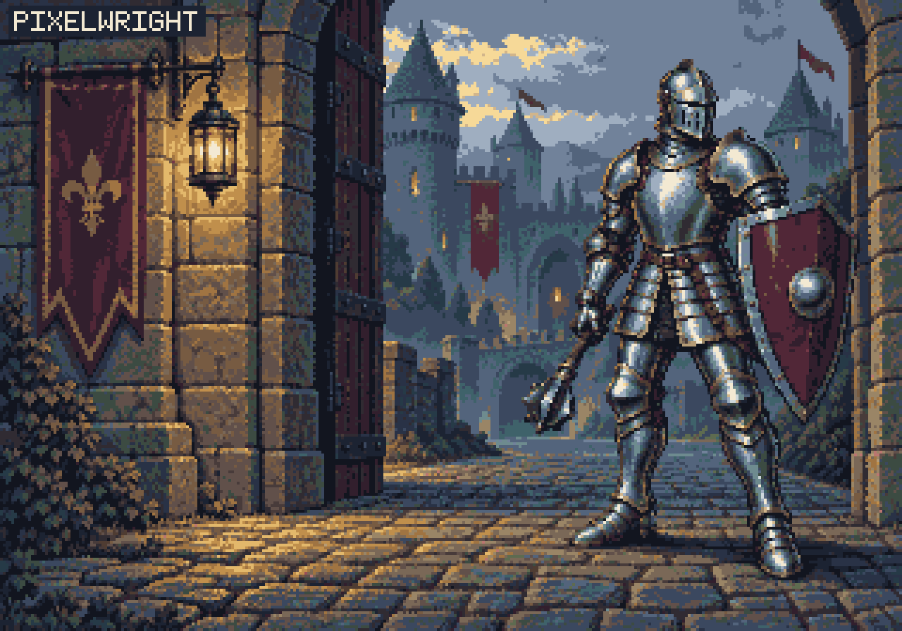

# Castle guard scene



The README showcase uses this final PNG: **1280×896**, rendered from **320×224** logical cells at **4×**. All **71,680** cells contain one exact RGBA value; all pixels are opaque and use the declared 32-color palette. The [strict QA report](report.json) records technical PASS. [Independent verification](verification.json) checks the native enlargement, colors, alpha, every grid boundary, and source hashes; artistic review is recorded separately as accepted.

[Native PNG](native.png) · [Full grid](grid_overlay.png) · [Transparent grid layer](grid_lines.png) · [Enlarged cells](grid-detail.png) · [Violation mask](violation_mask.png)

The grid shows every actual 4×4 px cell boundary in both directions. The enlarged detail covers a 64×64 px source region, enlarged equally by 8×; each displayed cell is 32×32 px. Diagnostic grid colors are separate from the artwork.

## Editable source

[artwork.json](artwork.json) is a single indexed logical matrix referencing [palette.json](palette.json). The shared library contains named steel, stone, lantern, burgundy, moss, and distant-teal ramps. The project contract is [profile.json](profile.json).

Run from the repository root after installing `pixelwright/requirements.txt`:

```sh
python pixelwright/scripts/pixel_build.py --spec docs/examples/castle-guard/artwork.json --out-dir runs/castle-guard-build-v1
python pixelwright/scripts/pixelwright.py inspect runs/castle-guard-build-v1/rendered.png --profile docs/examples/castle-guard/profile.json --out-dir runs/castle-guard-audit-v1
```

Choose a fresh output directory for each run. Rebuilding this matrix reproduces the published PNG byte for byte in the recorded Python 3.12.10 / Pillow 12.3.0 environment.

## Preserved generation and review

The [generated candidate](generated-source.png) and [actual prompt](generation-prompt.txt) are preserved. The 1499×1049 candidate **fails** the declared grid contract: [source QA](source-report.json). A new 1280×896 canvas, explicit cell projection, remapping to the predeclared 32-color palette, and a 5×7 logical wordmark edit produced this derived artwork. Projection and remapping are lossy.

Visual review accepted the common pixel density and lighting, the knight's fully framed equipment, the mace's connection to the gauntlet, the boots' ground contact, and the wall-mounted lantern. Technical PASS and artistic acceptance are separate conclusions. Source PNGs and the earlier four-layer tutorial remain preserved.
