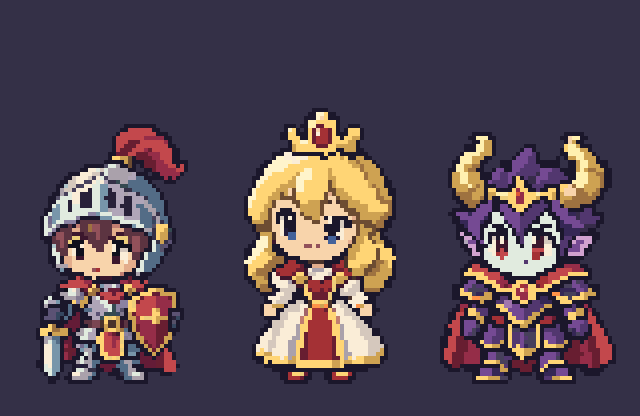
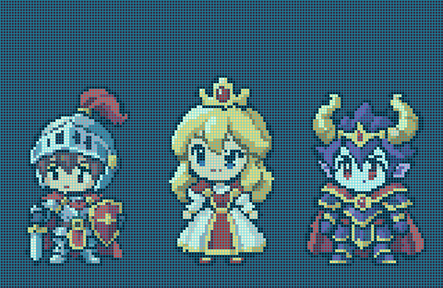

# SD 마왕성 필드 — 별도 생성과 실제 합성

캐릭터를 처음부터 다시 만든 예제다. 가로:세로 1:2인 **48×96 논리 캔버스**에 큰 얼굴과 짧은 팔다리의 **2등신 SD**를 배치한다. 기존 그림을 확대해 디테일이 늘었다고 설명하지 않는다. 이미지 생성 전 고정한 [디자인 계약](design-contract.json)을 기준으로 기사·공주·마왕·성을 각각 생성하고, 같은 64색 팔레트와 1× 게임 픽셀로 합성한다.

## 깨끗한 결과와 실제 격자





캐릭터 한 명은 48×96, 위 비교 캔버스는 160×104 논리 픽셀이며 물리 셀은 4×4픽셀이다. 청록색 선은 검사 격자다. 검사 오버레이는 완성 PNG와 별도로 보존한다. 개별 [기사](knight-4x.png)·[공주](princess-4x.png)·[마왕](demon-king-4x.png)와 각각의 [기사 격자](knight-grid_overlay.png)·[공주 격자](princess-grid_overlay.png)·[마왕 격자](demon-king-grid_overlay.png)를 볼 수 있다.


[논리 원본](scene-native.png) · [2304×1728 최근접 확대](../../images/game-sd-scene-6x.png) · [필드 격자](scene-preview-grid_overlay.png)

## 생성과 변환 기록

- 내장 `image_gen`으로 기사·공주·마왕·성을 **각각** 생성했다. 새 기사 시안은 나머지 생성의 화풍 참고로만 사용한다. 원본과 프롬프트는 보존한다.
- 생성 PNG 자체와 실제 게임 에셋을 별도로 검사한다. 생성 결과가 정해진 출력 크기·격자·팔레트·알파를 만족한다고 가정하지 않는다.
- 파생 경로는 알파 128 이상의 경계를 기준으로 프레이밍하고, 명시적인 대표 셀 투영·이진 알파·공통 팔레트 매핑을 거쳐 편집 가능한 토큰 행렬로 저장한다. 원본의 상태를 파생 에셋의 PASS로 바꾸어 보고하지 않는다.
- 바닥은 16×16 논리 셀로 직접 작성한 석재 4종과 이끼 4종이다. 지면 접촉 음영은 별도의 40×8 이진 알파 에셋이다. 투명도 혼합 없이 모든 요소를 같은 게임 픽셀로 합성한다.

[생성 원본·변환 내역](generation.json) · [전체 에셋 검사 요약](asset-summary.json) · [캐릭터 비교 검사](characters-report.json)

대표 셀 투영의 실제 비교: [기사](knight-projection-comparison.png) · [공주](princess-projection-comparison.png) · [마왕](demon-king-projection-comparison.png) · [성](castle-projection-comparison.png). 각 `*-projection-review.json`은 프레이밍한 중간 입력의 변경량이며, `*-projection-report.json`은 팔레트 매핑 전 중간 격자 검사다. 최종 공통 64색 검사는 아래의 완성 PNG 보고서로 판단한다.

각 `*-source-report.json`은 생성 원본, `*-report.json`은 4배 완성 PNG, `*-game-report.json`은 1× 게임 에셋의 결과다. 1× 게임 검사는 크기·팔레트·알파 등의 계약을 확인하며, 블록의 정확한 반복은 별도의 4배 PNG 검사로 확인한다.

검증 결과: 독립 에셋 **13개 모두 기술 PASS**, 필드 **110,592셀 모두 균일**, 비균일 셀·부분 알파·팔레트 이탈은 0이다. 정상 실행 화면은 독립 합성의 3배 확대와 RGBA 단위로 일치했다. 캐릭터의 실제 보이는 크기는 기사 38×65, 공주 38×69, 마왕 44×63이며 모두 같은 발 기준선에 놓인다. 원본 크기와 확대본을 함께 본 미술 검수 판정은 이 정적 SD 예제에 대해 `accepted`다. 이 판정은 기술 검사기의 자동 판정이 아니다.

## 빨간 캐릭터의 의미

이전 README의 빨간 캐릭터는 **의도적으로 격자를 어긴 복제 기사를 검사기가 빨간색으로 덮은 진단 이미지**였다. 오른쪽 회색 사각형은 반투명 혼합 오류를 검출하기 위해 넣은 효과다. 정상 필드의 적이나 새로운 캐릭터가 아니다.

이 예제도 `?fault=1`에서 동일한 실패 대조를 제공하지만, README의 대표 이미지는 정상 합성 화면이다. [의도적 실패 오버레이](runtime-injected-errors-overlay.png)는 완성 아트와 구분해서 제공한다. 빨간색은 비균일 셀, 자홍색은 팔레트 밖의 색을 표시한다.

## 브라우저 실행과 검증

```sh
python -m http.server 8000
# http://localhost:8000/pixelwright/examples/demon-castle-sd/
```

방향키는 정적 기사의 위치를 옮기고, R은 초기화, F와 Escape는 전체 화면을 전환한다. 걷기 애니메이션이 포함된 예제는 아니다. 발 위치 기준 앞뒤 가림, 건물·NPC·필드 경계 충돌과 정수 확대를 확인한다.

```sh
python tools/generate_sd_castle_example.py
node tools/check_castle_demo.mjs http://localhost:8000/pixelwright/examples/demon-castle-sd/ --sd
python tools/generate_sd_castle_example.py --verify-runtime
```

기본 빌드는 저장된 토큰 행렬을 사용한다. 생성 원본에서 파생 과정을 다시 수행하려는 경우에만 `--import-generated`를 사용한다. [브라우저 검증](runtime-verification.json)과 [독립 합성 비교](composition-verification.json)는 실제 실행 결과를 기록한다.

미술 품질 판정은 [art-review.json](art-review.json)에 별도로 남긴다. 기술 규격 PASS만으로 얼굴 표현·신체 비율·재질·접촉·조화를 자동 승인하지 않는다.
