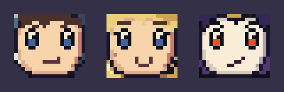
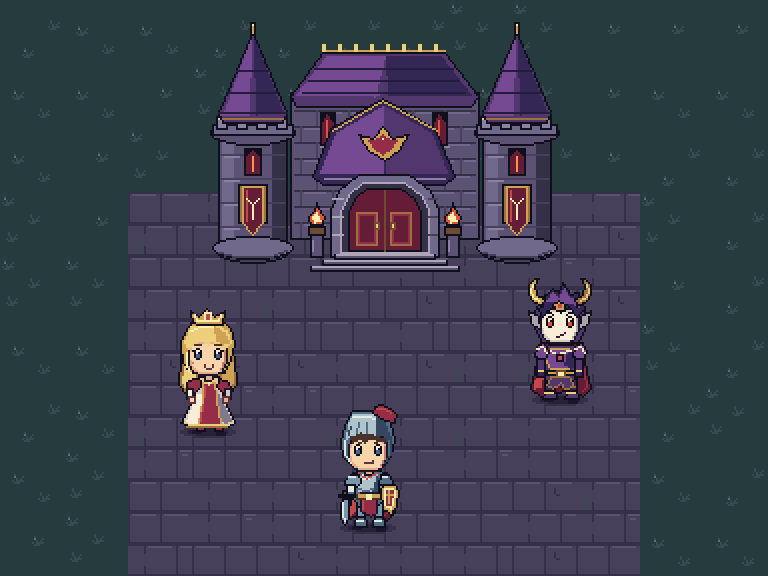

# 최종 논리 크기에서 제작한 SD 마왕성 필드

맵과 에셋의 최종 크기를 **그리기 전에** [디자인 계약](design-contract.json)에 고정하고, [사전 규격 커밋](https://github.com/arden-deq/pixelwright/commit/8e39a33) 뒤에 도트를 작성했다. 완성 에셋은 편집 가능한 네이티브 셀 행렬이다.

| 요소 | 최종 논리 PNG | 타일 기준 |
| --- | --- | --- |
| 맵 | 384×288 | 12×9타일 |
| 바닥 8종 | 각각 32×32 | 1×1타일 |
| 기사·공주·마왕 | 각각 32×64 | 1×2타일, 2등신 |
| 성 | 192×128 | 6×4타일 |
| 접촉 그림자 | 28×6 | 발 위치에 별도 합성 |

공통 64색과 투명색, 이진 알파, 좌상단 광원, 선택적 1논리픽셀 외곽선을 사용한다. 캐릭터의 발 기준선은 y=62다. 1× PNG가 실제 게임 원본이며, 확대 파일은 이 셀을 정수 배율로 반복한 것이다.

## 완성 셀과 표정


캐릭터 한 명은 32×64, 비교 캔버스는 112×72 논리 픽셀이다. 물리 셀은 6×6픽셀이고 기술 검사는 PASS다. 청록색은 셀 경계다. 모든 셀 경계가 표시되며 격자 선을 샘플링하지 않았다. 오버레이는 완성 아트와 별도 파일이다.



얼굴 영역은 20×18, 각 눈은 4×6, 입 배치는 5×3이다. 공주는 연결된 U자 미소, 기사는 한쪽이 살짝 올라간 잔잔한 미소, 마왕은 각진 눈썹과 자신 있는 웃음이다. 눈의 어두운 테두리·흰 하이라이트·청색 또는 적색 눈동자를 각각 셀로 정했다. [얼굴 논리 원본](faces-native.png) · [실제 얼굴 검사 격자](faces-grid_overlay.png) · [표정 셀 설계](face-design.json).

표정 보존 검사는 설계한 눈·입의 색을 1× PNG와 대조하고, 불투명 얼굴 셀이 합성 맵에서 가려지거나 바뀌지 않았는지 확인한다. 이어 실제 브라우저의 얼굴 영역을 합성 맵의 정확한 3배와 RGBA 단위로 비교한다. 모서리의 투명 셀은 배경이 보이는 것이 정상이라 별도로 다룬다. 이 검사는 **작성한 표정의 보존**을 확인하며, 예쁜 표정인지 자동 판정하는 기능은 아니다. [얼굴 보존 결과](face-preservation.json).

## 독립 에셋과 맵 합성



[맵 논리 원본](scene-native.png) · [2304×1728, 6배 PNG](../../images/game-native-field-6x.png) · [실제 맵 검사 격자](scene-preview-grid_overlay.png) · [독립 에셋 보드](../../images/game-sd-assets-preview.png).

기사·공주·마왕·성·바닥 8종·그림자를 각자의 PNG로 빌드하고, 사전에 정한 정수 좌표와 발 기준점으로 합성한다. 게임은 캐릭터 발 위치로 앞뒤 가림을 정렬한다. 건물·NPC·경계 충돌과 정수 확대를 지원한다. 방향키는 정적인 기사의 위치를 옮기며 걷기 프레임은 포함하지 않는다.

## 제작과 재현

[셀 작성 도구](../../../tools/author_sd_castle_cells.py)는 최종 크기의 도형·표정 셀을 작성해 [캐릭터 및 타일 행렬](../../../pixelwright/examples/demon-castle-sd/)로 저장한다. 기존 생성 PNG를 읽거나 축소하지 않는다. [빌드 도구](../../../tools/generate_sd_castle_example.py)는 저장된 셀을 Pixelwright의 `pixel_build.py`로 렌더링하고, 각 에셋의 게임 계약과 확대 PNG를 검사한다. 자동 축소·팔레트 치환·격자 투영 경로는 이 예제 빌드에서 제거했다.

```sh
# 도형 설계에서 원본 셀을 다시 작성할 때만 실행한다.
python tools/author_sd_castle_cells.py
# 저장된 최종 셀에서 PNG와 검사 기록을 재현한다.
python tools/generate_sd_castle_example.py
python -m http.server 8000
# http://localhost:8000/pixelwright/examples/demon-castle-sd/
node tools/check_castle_demo.mjs http://localhost:8000/pixelwright/examples/demon-castle-sd/ --sd
python tools/generate_sd_castle_example.py --verify-runtime
```

[네이티브 제작 기록](native-authoring.json)에는 사전 규격·팔레트·작성 도구·셀 행렬의 해시와 래스터 입력 0개를 기록했다. 빌드는 셀 행렬과 규격의 해시를 확인한다. 직접 행렬을 수정하는 경우 제작 기록의 해시도 새 버전으로 남겨야 한다. [기술 검사 요약](asset-summary.json) · [네이티브 크기·색·실루엣 기록](native-metrics.json).

검증 결과:

- 독립 에셋 13개의 1× 게임 계약과 4배 PNG 격자 검사 PASS.
- 캐릭터 2·3·4·6배, 얼굴 3·6배, 맵 2·3·6배 검사 PASS.
- 맵 110,592셀의 비균일 셀·부분 알파·팔레트 이탈 0.
- 실제 3배 실행 화면과 독립 합성 전체가 RGBA 일치. 세 얼굴 영역도 각각 일치.
- 실제 브라우저에서 로딩·이동·초기화·건물/NPC/경계 충돌·앞뒤 가림·전체 화면을 확인하고 콘솔 오류 0.
- 네이티브 대신 2배 기사를 입력한 intake 대조는 예상대로 FAIL.
- 의도적 실행 오류는 비균일 754셀·팔레트 이탈 96셀로 예상대로 FAIL.

[브라우저 검사](runtime-verification.json) · [합성 비교](composition-verification.json) · [변경하지 않은 웹 게임 클라이언트의 실행 기록](game-client-verification.json) · [미술 검수](art-review.json).

## 이전 결과와 빨간 진단 이미지

이전 결과는 큰 생성 시안을 자동 투영하고 팔레트를 치환해 표정이 손상됐다. 당시 미술 승인은 [철회 기록](projected-v1-review.json)에 남겼다. [당시 계약](projected-v1-design-contract.json), [생성 시안 내역](generated-concepts.json), [과거 프롬프트](prompts.json)와 원본 PNG는 참고 자료로 보존한다. 이 파일들은 새 네이티브 에셋의 제작 입력이 아니다. `*-source-*`와 `*-projection-*` 보고서는 그 과거 경로의 기록이며, 새 아트의 합격 근거로 사용하지 않는다.

첨부 사진의 빨간 복제 기사는 격자를 어긴 영역을 검사기가 표시한 것이다. 회색 사각형은 반투명 혼합 오류를 검출하려고 넣은 효과다. 정상 대표 화면과 구분해 [의도적 실패 오버레이](runtime-injected-errors-overlay.png)로 제공한다. `?fault=1`에서만 재현된다.

## README 표시 규격

창 너비에 따라 캐릭터는 6·4·3·2배, 얼굴은 6·3배 PNG를 선택하도록 구성했다. 각 파일은 최종 논리 원본을 정수 배율로 확대한 결과다. 이번 재제작의 최종 승인에는 PNG·셀 행렬·표정 보존에 대한 파일 검사를 사용하며, 추가 Playwright 검수는 수행하지 않는다. [표시 검사 범위 기록](github-rendering.json).
