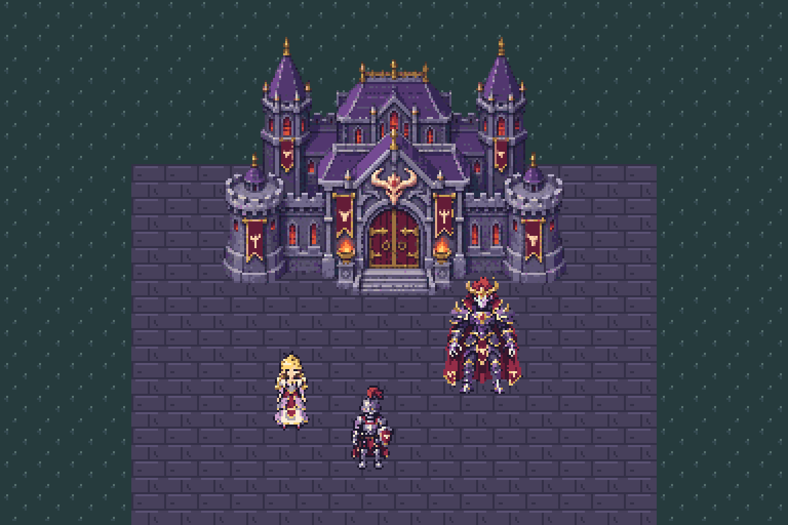
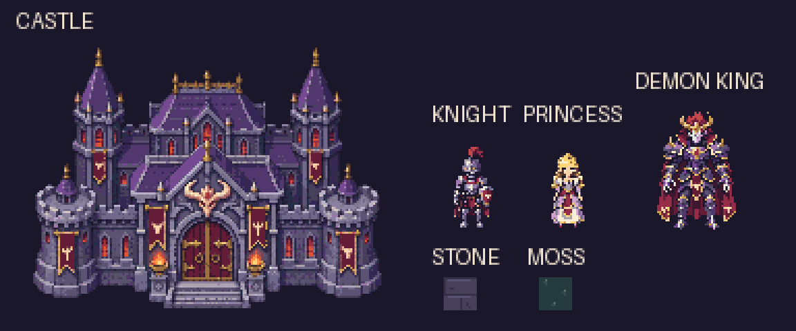
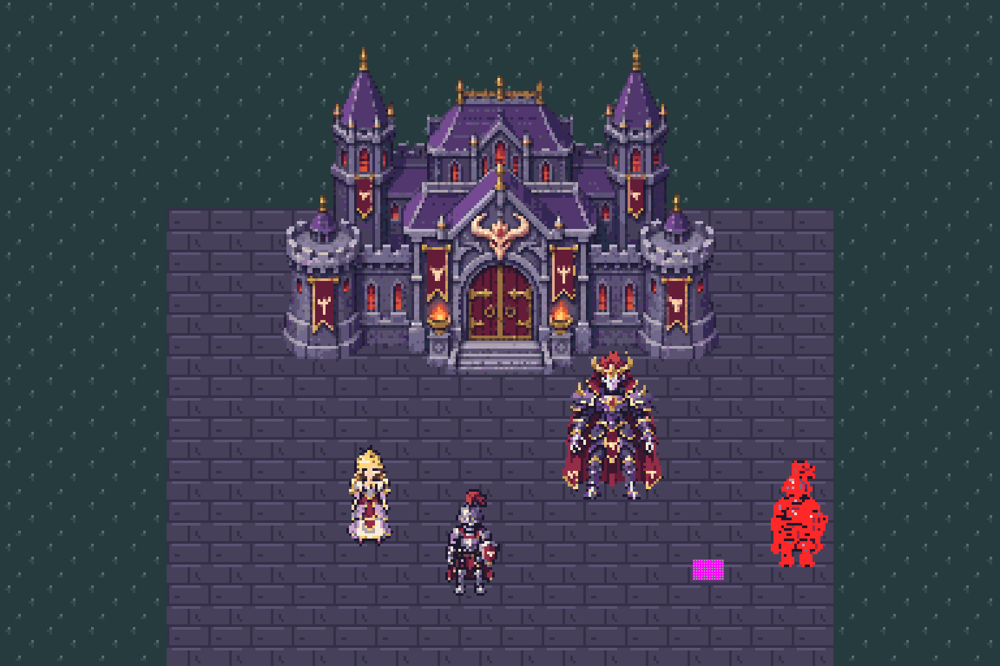
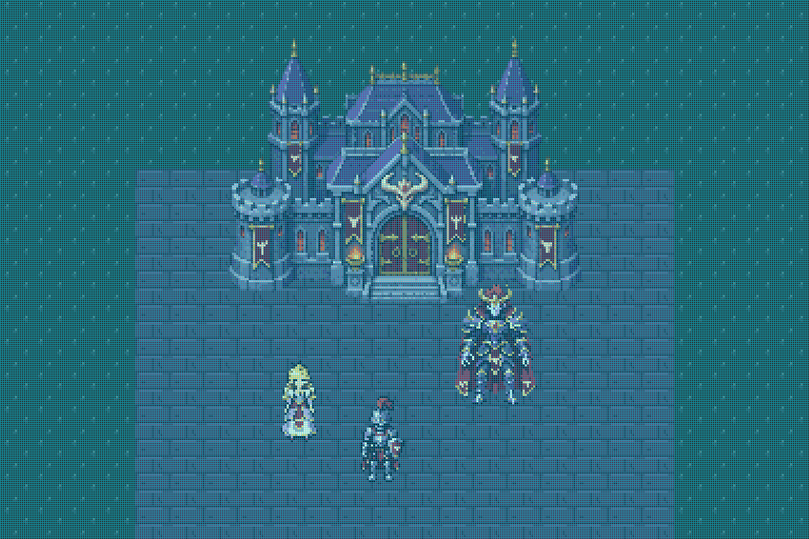

# 마왕성 RPG Maker풍 필드 — 생성·합성·검증 기록

마왕성·기사·공주·마왕을 각각 생성하고, 석재·이끼 타일과 함께 실제 웹 캔버스에서 합성한 예제다. README의 그림은 실행 중인 브라우저에서 캡처했다. 고정 계약은 [game.json](../../../pixelwright/examples/demon-castle/game.json), 실행 코드는 [예제 폴더](../../../pixelwright/examples/demon-castle/)에 있다.

후속 [Playwright 시각 재검수](quality-review/README.md)에서는 **기술 PASS와 별개로 미술 품질의 균일함은 개선 필요**로 판정했다. 타일의 디테일 밀도, 인간 캐릭터의 작은 부위 표현, 마왕의 잔점과 지면 접촉 표현을 구체적으로 기록했다. README의 비정수 축소 문제도 확인해 정수 미리보기와 6배 확대 파일을 분리했다.



## 고정 규격과 개별 에셋

기본 화면 384×256, 타일 16×16, 공통 팔레트 64색과 투명색, 이진 알파를 사용한다. 모든 게임 입력은 1× PNG다. 3/4 탑다운 시점, 좌상단 광원, 셀 음영, 선택적인 어두운 1픽셀 외곽선을 브리프로 정했다. 광원·형태·분위기와 선택적 외곽선의 완성도는 시각 검토 대상이다.

| 독립 PNG | 논리 크기 | 가시 색 수 | 게임 계약 검사 |
| --- | --- | --- | --- |
| [마왕성](../../../pixelwright/examples/demon-castle/build/castle.png) | 192×128 | 49 | PASS |
| [기사](../../../pixelwright/examples/demon-castle/build/knight.png) | 32×48 | 31 | PASS |
| [공주](../../../pixelwright/examples/demon-castle/build/princess.png) | 32×48 | 28 | PASS |
| [마왕](../../../pixelwright/examples/demon-castle/build/demon-king.png) | 64×64 | 31 | PASS |
| [석재](../../../pixelwright/examples/demon-castle/build/stone.png) | 16×16 | 3 | PASS |
| [이끼](../../../pixelwright/examples/demon-castle/build/moss.png) | 16×16 | 3 | PASS |

[개별 보고서와 해시 요약](asset-summary.json)에서 6개 모두 오류 없이 PASS다. 전체 필드는 팔레트 중 52색을 쓴다. 성 검사에서 디더링 후보 9픽셀이 측정되었으나 도구의 검출 임계값 미만이다. 기술 PASS가 화풍의 완성도를 보증하지는 않는다.



## 실제 이미지 생성과 파생 에셋

내장 `image_gen` 도구의 생성 모드로 네 이미지를 **각각** 만들었다. 투명 배경, 동일한 시점·광원·재질 색상 계열을 요청했다. 정확한 프롬프트와 변경하지 않은 원본을 보존했다.

| 대상 | 프롬프트 | 생성 원본 | 원본 검사 |
| --- | --- | --- | --- |
| 성 | [castle-prompt.txt](castle-prompt.txt) | [1536×1024](castle-generated.png) | [FAIL](castle-source-report.json) |
| 기사 | [knight-prompt.txt](knight-prompt.txt) | [1024×1536](knight-generated.png) | [FAIL](knight-source-report.json) |
| 공주 | [princess-prompt.txt](princess-prompt.txt) | [1024×1536](princess-generated.png) | [FAIL](princess-source-report.json) |
| 마왕 | [demon-king-prompt.txt](demon-king-prompt.txt) | [1254×1254](demon-king-generated.png) | [FAIL](demon-king-source-report.json) |

성·기사·공주 원본은 선언한 격자의 셀 균일성, 색상 수, 알파 또는 허용 팔레트를 충족하지 못했다. 마왕 원본은 요청한 1024×1024와 크기가 달라 기하 검사에서 중단되었다. 원본을 통과한 것으로 바꾸어 보고하지 않았다.

파생 과정은 `tools/generate_castle_example.py --import-generated`에 재현되어 있다.

1. 원본 PNG를 해당 `*-source-profile.json`으로 검사하고 FAIL을 보존한다.
2. 기존 `pixel_qa.py fix`의 대표 셀 투영과 이진 알파 처리를 적용한다. 성은 8× 격자, 인간은 32× 격자에서 선언한 논리 크기로 내보낸다.
3. 마왕은 원본을 수정하지 않고 별도 입력에 사방 13픽셀 투명 여백을 넣어 1280×1280으로 만든 뒤, 20× 격자에서 64×64로 투영한다. 이 예외는 [generation.json](generation.json)에 기록했다.
4. 기존 `pixel_palette.py remap`으로 고정 팔레트에 매핑하고 파생 결과를 다시 검사한다.
5. 결과를 편집 가능한 인덱스 행렬로 저장하고, `pixel_build.py`로 게임용 1× PNG를 재생성한다. 바닥 두 타일은 처음부터 인덱스 행렬로 제작했다.

원본 파일의 SHA-256은 유지된다. 최종 PNG는 격자 투영과 팔레트 변환을 거친 **파생 에셋**이며, 원본 생성 품질과 구분한다.

## 화면 합성과 실행 검증

`field.json`의 24×16 타일 맵에 독립 건물·캐릭터를 발 위치 기준으로 배치한다. 캐릭터를 발의 Y좌표로 정렬하여 앞뒤 가림을 처리하고, 성의 바닥 영역과 NPC 발 주변에는 충돌을 둔다. 384×256 캔버스를 먼저 완성한 뒤 전체 화면을 정수 배율로 한 번만 확대한다.

[Playwright 실행 기록](runtime-verification.json)의 결과:

- 6개 PNG를 모두 로드했으며 브라우저 오류는 0개다.
- 오른쪽 방향키 20프레임으로 기사 위치가 `(181,229)`에서 `(201,229)`로 이동했다.
- 성 충돌은 `(181,150)`, 마왕 충돌은 `(235,200)`, 오른쪽 경계는 `x=312`에서 멈췄다.
- 기사를 공주 뒤로 이동시켜 [가림 화면](runtime-depth.png)을 캡처했다.
- 초기화, 전체 화면 진입·종료, 3배·4배 정수 확대를 통과했다. 240×160 창에서는 비정수 축소를 거부한다.
- 별도로 Pillow에서 합성한 [원본 해상도 장면](scene-native.png)의 3배 확대와 브라우저 화면이 RGBA 픽셀 단위로 완전히 일치했다. [비교 기록](composition-verification.json)

이 데모는 정적 캐릭터의 배치·이동·충돌·가림을 확인한다. 걷기 프레임, 공격, 대화 기능은 구현하지 않았다.

## 검사기의 정상·실패 대조

| 입력 | 실제 결과 | 근거 |
| --- | --- | --- |
| 정상 브라우저 화면, 1664×1088 창의 4배 표시 | PASS, 98,304셀 중 불균일 0 | [보고서](runtime-clean-report.json) · [원본 캡처](runtime-clean.png) |
| README의 1152×768 브라우저 화면, 3배 표시 | PASS, 98,304셀 균일, 팔레트 밖 0, 부분 알파 0 | [엄격한 격자 보고서](scene-report.json) |
| 2배로 내보낸 64×96 기사 | FAIL: `COARSE_PIXELS`, `PIXEL_SIZE_DIFFERS`, `CATEGORY_SIZE` | [보고서](intake-report.json) · [비교 그림](../../images/game-intake.png) |
| `?fault=1` 실제 화면 | FAIL: `CELL_NOT_UNIFORM` 453셀, `COLOR_OUTSIDE_PALETTE` 96픽셀 | [보고서](runtime-injected-errors-report.json) · [원본 캡처](runtime-injected-errors.png) |

`?fault=1`은 검사 대조용으로 기사 하나를 화면 픽셀 2개만큼 어긋나게 그리고, 투명도 50%의 흰 사각형을 추가한다. README의 빨강·자홍 표시는 검사기가 실제로 출력한 진단 그림이다.





보고서의 `artistic_status: not_reviewed`는 자동 검사기의 범위다. 별도로 논리 해상도와 확대 화면을 시각 검토하여 성·갑옷·드레스·뿔과 망토의 식별성, 공통 시점과 보라색 석재·붉은색·금색의 조화를 확인했다. 32×48 캐릭터에서는 얼굴과 장식 일부가 단순화된다. 고립 색상 후보는 미학적 통과 판정에 사용하지 않는다.

## 재현

저장소 루트에서 Python 의존성을 설치한 뒤 실행한다.

```sh
python -m pip install -r pixelwright/requirements.txt
python tools/generate_castle_example.py
python -m http.server 8000
```

<http://localhost:8000/pixelwright/examples/demon-castle/>에서 방향키·R·F로 조작한다. 브라우저 자동 검증에는 선택 의존성인 Playwright와 Chromium을 설치한다. 서버를 실행해 둔 별도 터미널에서:

```sh
npm install --prefix .work/browser-runtime --no-save playwright
node .work/browser-runtime/node_modules/playwright/cli.js install chromium
node tools/check_castle_demo.mjs http://localhost:8000/pixelwright/examples/demon-castle/
python tools/generate_castle_example.py --verify-runtime
```

`generate_castle_example.py`의 기본 실행은 커밋된 인덱스 행렬에서 에셋·합성·정상 검사·2배 기사 거부 결과를 재생성한다. 브라우저 검사 이후 `--verify-runtime`은 실제 캡처를 검사하고 README 그림과 보고서를 갱신하며, 독립 합성과의 픽셀 일치도 확인한다. 생성 원본에서 다시 파생하려면 일반 재생성 대신 `--import-generated`를 명시한다. 원본 이미지를 다시 생성하는 호출은 포함하지 않는다.

2026-11-03에 기존 단위 테스트 259개, 브라우저 통합 검증, 설치 ZIP의 독립 실행 검증을 통과했다. 설치 검증은 새 예제의 에셋 6개와 HTML·JavaScript·맵 파일 포함 여부도 확인한다.
