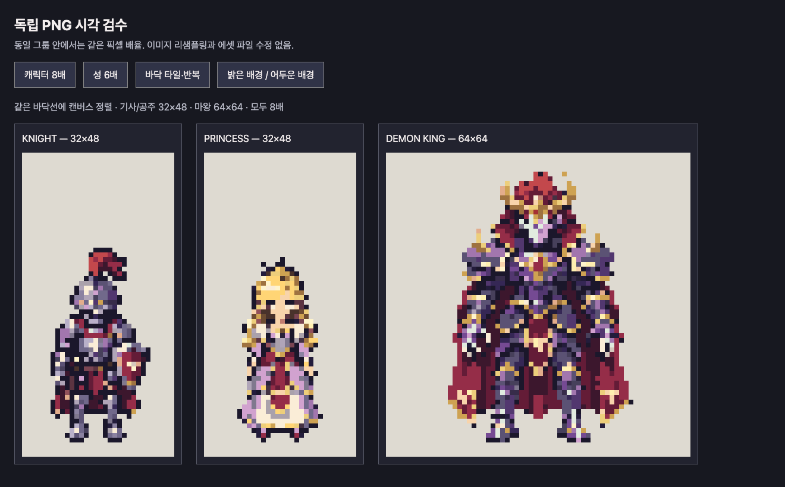
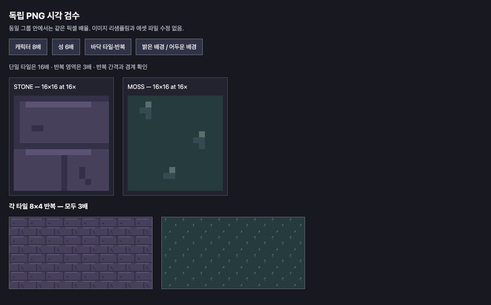
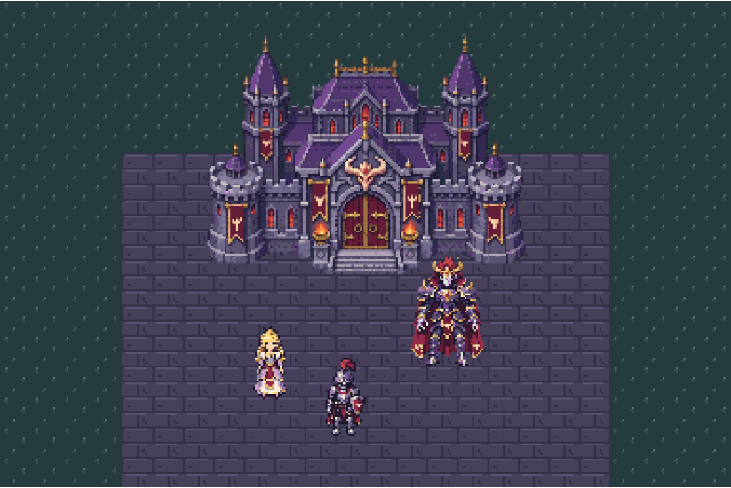

# Playwright 에셋 품질 재검수 — 2026-11-03

**판정: 기술 규격은 PASS, 미술 품질의 균일함은 개선 필요(`changes_needed`).**

`playwright` 스킬의 CLI로 실제 Chromium에서 독립 에셋·반복 타일·합성 화면·GitHub README를 확인했다. 캐릭터는 동일한 8배 배율로 밝고 어두운 배경에 놓고, 성은 6배, 타일 한 장은 16배와 반복 배치 3배로 비교했다. 캡처의 글자·체커보드는 검수용이며 게임 에셋에 포함되지 않는다. 검수 과정에서 게임 입력 PNG는 변경하지 않았다.

## 확인한 문제

| 우선순위 | 대상 | 실제 관찰 | 필요한 개선 |
| --- | --- | --- | --- |
| 높음 | 바닥과 성·캐릭터의 조화 | 석재와 이끼는 각각 3색의 단순 반복 패턴이다. 성의 풍부한 재질·명암과 나란히 보면 마감 수준 차이가 크다. 같은 균열과 이끼 점무늬가 일정 간격으로 반복되어 격자가 드러난다. | 배색은 유지하되 재질 클러스터를 다듬고 변형 타일·지형 경계를 추가해 같은 게임의 배경으로 맞춘다. 색 수 자체를 품질 점수로 취급하지 않는다. |
| 높음 | 기사·공주의 작은 디테일 | 기사의 갑옷·장비 경계와 공주의 얼굴·장식이 작은 색 덩어리로 합쳐졌다. 역할의 큰 실루엣은 알아볼 수 있지만, 작은 격자에서 의도적으로 정리한 표현이 부족하다. 공통 캔버스와 팔레트만으로 부위별 묘사 방식이 같아지지 않았다. | 큰 생성 이미지를 단순 투영하는 단계 뒤에 실제 32×48에서 얼굴·손·장비 경계와 명암 덩어리를 다시 설계한다. |
| 중간 | 마왕의 잔점 | 논리 좌표 `(37,4)`에 몸체와 분리된 불투명 1픽셀이 있다. 밝은 배경과 어두운 배경 모두에서 머리 오른쪽 위의 불필요한 점처럼 보인다. | 장식 의도를 확인하여 뿔에 연결하거나 제거한다. 고립 점을 자동 불량으로 단정하는 규칙은 추가하지 않았다. |
| 중간 | 캐릭터의 지면 접촉 | 세 캐릭터 모두 바닥과 만나는 접촉 음영이 없어 화면에서 따로 놓은 느낌이 남는다. | 동일한 광원과 형태 규칙의 접촉 그림자를 별도 에셋으로 설계하고 합성 화면에서 확인한다. |



[어두운 배경 대조](characters-dark.png) · [성 확대 검수](castle-light.png)



## 유지되는 일관성

- 여섯 PNG는 모두 정해진 캔버스 크기·공통 팔레트·이진 알파·1× 픽셀 크기의 게임 계약 검사를 다시 통과했다. [이번 검사 요약과 입력 해시](technical-summary.json)
- 기사와 공주는 모두 발 아래 경계가 `y=45`다. 보이는 높이는 각각 41·39픽셀이다. 이 작은 키 차이는 자연스러운 차이일 수 있으며 품질 불균일 판정의 근거로 삼지 않았다.
- 성·갑옷·마왕의 보라색, 붉은색, 금색 계열은 연결된다. 이 색상 조화는 긍정적이지만 타일과 오브젝트의 디테일 차이를 해결하지는 못한다.
- 실제 브라우저에서 다시 캡처한 [1152×768 필드](field-live-3x.png)는 384×256 논리 합성의 최근접 3배 확대와 RGBA 픽셀 단위로 일치했다. 합성·필터링 오류가 그림의 디테일을 지운 것은 아니다.

측정값은 [native-metrics.json](native-metrics.json)에 있다. 마왕의 알파 영역은 8방향 연결 기준으로 몸체 하나와 1픽셀 영역 하나다. 그 외 에셋은 각각 하나의 연결 영역이다. 연결 영역·색 수는 검수 증거이며 독립적인 미학 점수가 아니다.

## README가 흐려 보인 별도 원인과 수정

1280×900 Chromium 창에서 기존 GitHub README의 필드 이미지를 측정했다.

| 항목 | 기존 값 |
| --- | --- |
| 원본 PNG | 1152×768, 논리 384×256의 3배 |
| 실제 CSS 표시 | 약 822.984×548.656 |
| 논리 도트 하나의 CSS 폭 | 약 2.143픽셀 |
| 이미지 보간 | `image-rendering: auto` |



브라우저가 3배 PNG를 비정수 배율로 축소하면서 도트 경계가 흐려졌다. 이를 위해 README의 필드·에셋 비교·화면 진단 그림을 `<picture>`로 바꾸고, 넓은 화면에는 2배 PNG, 1279픽셀 이하 창에는 1배 PNG를 제공한다. 필드의 [2304×1536 확대 파일](../../../images/game-scene-6x.png)도 별도로 제공한다. 논리 디테일은 384×256 그대로이며 6배 파일이 새로운 얼굴·장식 정보를 만드는 것은 아니다. 콘텐츠 폭이 논리 원본 폭보다도 좁으면 추가 축소가 생길 수 있다.

기존 브라우저 원본 캡처와 검사기 원본 오버레이는 보존했다. 새 미리보기·확대 파일은 최근접 정수 배율로만 내보냈으며, [내보내기 크기와 해시](../readme-exports.json), [2배 격자 검사](../readme-preview-report.json), [6배 격자 검사](../readme-6x-report.json)를 남겼다.

푸시한 브랜치의 실제 GitHub 페이지에서도 확인했다. 아래 측정은 모두 DPR 1인 Chromium에서 수행했다. 필드 외에 에셋 비교 그림과 화면 진단 그림도 각 창에서 선택된 PNG의 원래 크기 그대로 표시되었다.

| 브라우저 창 | 선택된 필드 PNG | 실제 CSS 표시 | 논리 도트 하나의 CSS 폭 |
| --- | --- | --- | --- |
| 1280×900 | 768×512 | 768×512 | 2픽셀 |
| 1000×900 | 384×256 | 384×256 | 1픽셀 |
| 640×900 | 384×256 | 384×256 | 1픽셀 |


[1000픽셀 창 캡처](github-readme-field-after-1000.png) · [640픽셀 창 캡처](github-readme-field-after-640.png) · [DOM 크기·소스·픽셀 비교 기록](github-rendering.json)

각 필드 캡처의 그림 영역은 내보낸 PNG와 RGBA 픽셀 단위로 일치하며 52색을 유지한다. DOM의 소수점 위치를 정수 영역으로 캡처하면서 생긴 흰색 한 줄은 비교 영역 밖에 있다. 캡처를 자르거나 보정하지 않고, 그 여백과 정확히 일치하는 영역의 좌표를 기록했다. 이는 비정수 축소로 인한 흐림이 해결된 증거이며 캐릭터의 원래 미술 디테일이 개선되었다는 뜻은 아니다.

## 재현

저장소 루트에서 `python -m http.server 8000`을 실행하고 [독립 에셋 검수 페이지](http://localhost:8000/docs/examples/demon-castle/quality-review/inspect.html)를 연다. [검수 페이지 소스](inspect.html)도 함께 보존했다. `output/playwright/asset-quality-review/`를 작업 경로로 `playwright_cli.sh --session=castle-review`를 사용하여 스냅샷으로 버튼 참조를 확인한 뒤 밝은/어두운 배경·성·타일 보기를 전환하고 캡처했다. GitHub 페이지에서는 원본 이미지 크기, DOM 표시 크기, DPR, 보간 설정을 `eval`로 읽었다. 계정 로그인이나 외부 페이지 수정은 하지 않았다.

README 내보내기는 다음 명령으로 재현한다.

```sh
python tools/generate_castle_example.py --export-readme
```

정수 배율의 기술 검사는 수정된 미리보기를 검증한다. 위의 미술적 개선 사항은 여전히 남아 있으며 이번 README 표시 수정으로 해결되었다고 보고하지 않는다.
