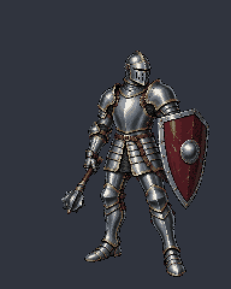
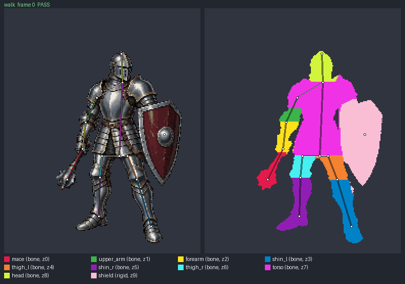

# README knight in motion

The full plate knight from the README header, animated with `pixel_sprite.py`: a mace swing, a shield block and a walk cycle. Every animation passes the strict sheet audit and the declared rig check with the default tolerances.

These frames turn cut-out parts of the published knight. For frames drawn new on each skeleton instead, see the [skeleton-first generation kit](poses/).

| Mace swing | Shield block | Walk |
| --- | --- | --- |
|  |  |  |
| 8 frames · 1.0 s | 6 frames · 0.94 s | 8 frames · 0.96 s |

Each `-rig.gif` plays the same frames with the declared skeleton over the art (left) and every dot colored by its part (right):




## How it was made

[`tools/generate_knight_animations.py`](../../../tools/generate_knight_animations.py) cuts the published 8 px knight ([`docs/examples/knight/8px/artwork.json`](../knight/8px/artwork.json), 128×192 logical cells, 32 colors) along its plate seams into ten parts, listed back to front: mace, upper arm, forearm, both shins, both thighs, torso, head and shield. Fourteen joints form the skeleton: crown, neck, pelvis, shoulder, elbow, hand, mace head, shield grip, and hip, knee and ankle on each leg.

- The torso and head are bones that only move by whole cells, so their dots stay exact; the shield is `rigid` around its grip and is checked as an exact copy.
- Arm, mace and leg bones turn about their joints with a RotSprite-style resampler (three Scale2x passes, rotation, one sample per cell), so every frame uses only the knight's original 32 colors. Leg poses use two-bone IK, which keeps thigh and shin lengths.
- Where a moving part could uncover cells hidden under a part drawn in front of it, the hidden part was extended under that front part by repeating its own interior dots; arm pieces extend only between their own joints, so nothing pokes past the shoulder or through the fist. Frame 0 of every animation is identical, cell for cell, to the README knight.
- Rotation can break off a few dots. Islands smaller than four cells are dropped, and arm angles are nudged by at most 3° so the mace and arm stay in one piece; the nudged angles are what the joints record.

Frames are 192×240 logical cells, rendered at 2× in each sheet and previewed at 2× (384×480 per GIF frame).

| Animation | Part-frame comparisons | Bone shape match | Size ratio | Largest drift |
| --- | ---: | ---: | ---: | ---: |
| [Swing](swing/sprite_report.json) | 80 | ≥ 99.5% | 0.96–1.00 | 0.26 cells |
| [Block](block/sprite_report.json) | 60 | ≥ 99.5% | 0.96–1.00 | 0.48 cells |
| [Walk](walk/sprite_report.json) | 80 | ≥ 99.5% | 0.93–1.00 | 0.22 cells |

The walk reports `BASELINE_SHIFT` as information because the lifted foot raises the lowest row. Rig checks confirm that each part keeps its dots consistent with the skeleton; timing, weight and the in-place march are artistic choices reviewed by eye.

## Reproduce

Run from the repository root after installing `pixelwright/requirements.txt`:

```sh
python tools/generate_knight_animations.py --out-dir runs/knight-animation-v1
python pixelwright/scripts/pixel_sprite.py build --spec runs/knight-animation-v1/swing/spec.json --out-dir runs/knight-swing-build-v1
python pixelwright/scripts/pixel_sprite.py check --spec runs/knight-animation-v1/swing/spec.json --sheet runs/knight-swing-build-v1/rendered.png --profile runs/knight-animation-v1/swing/profile.json --out-dir runs/knight-swing-check-v1 --preview-scale 2
```

Use `block` or `walk` in place of `swing` for the other animations. The unit tests confirm that the generator reproduces the committed specs byte for byte. Each folder keeps the spec, profile, audited sheet (`rendered.png`), sheet audit, sprite report, rig overlay and both GIFs; GIFs and overlays are diagnostics, and the sheet is the audited artwork.
