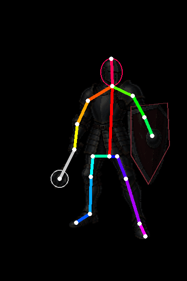
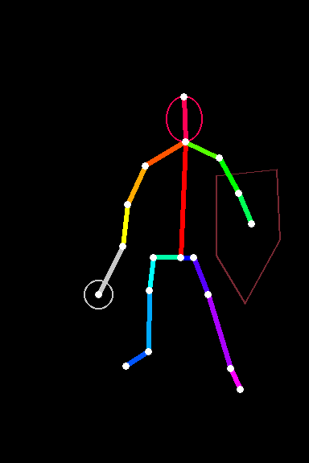
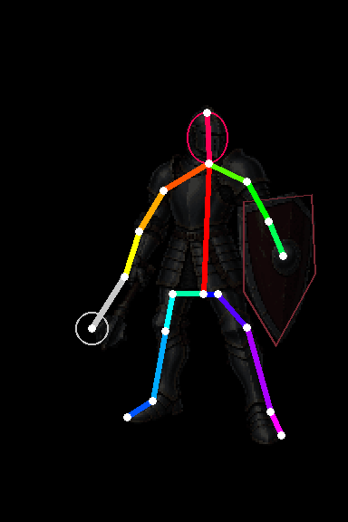

# Skeleton-first knight animation kit

The skeleton comes first; each frame is then redrawn by an image model as the same knight in that pose. [`tools/knight_pose_guides.py`](../../../../tools/knight_pose_guides.py) writes this kit from the README knight's joints.

| Mace swing (downward smash) | Shield block | Walk |
| --- | --- | --- |
|  |  |  |
| 9 frames | 6 frames | 8 frames |

The previews show each skeleton over a faint copy of the knight at rest, so scale and placement can be judged before anything is generated.

## Contents

| File | Purpose |
| --- | --- |
| `reference.png` | The README knight at rest on the 1024×1536 generation canvas (transparent background) |
| `<animation>/pose_NN.png` | OpenPose-style guide for frame NN on the same canvas; the dark red outline marks the shield and the gray line with a circle marks the mace |
| `prompts.json` | Per frame: the two input images, the prompt and the expected output path |
| `poses.json` | Joint coordinates per frame in logical cells (frame 192×288; the knight's 128×192 cells start at 48,56) and frame durations |

## Generate with Codex imagegen

For each entry in `prompts.json`, give Codex's image generation the two listed images in order (reference first, pose second) and the prompt, at 1024×1536. Save the result at the listed `output` path, for example `generated/swing/frame_06.png`. Keep the canvas size; do not crop or rescale.

A generated frame is an unverified candidate. The next step projects every frame onto the 192×288 logical grid, limits it to the knight's 32 colors, assigns each dot to a part by its nearest bone, assembles one sheet per animation, and runs `pixel_sprite.py check`. A frame whose limbs do not follow its skeleton fails the rig check and is regenerated rather than accepted.

Regenerate this kit after changing a pose:

```sh
python tools/knight_pose_guides.py
```
