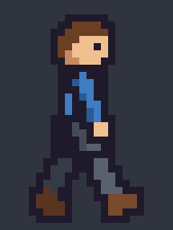
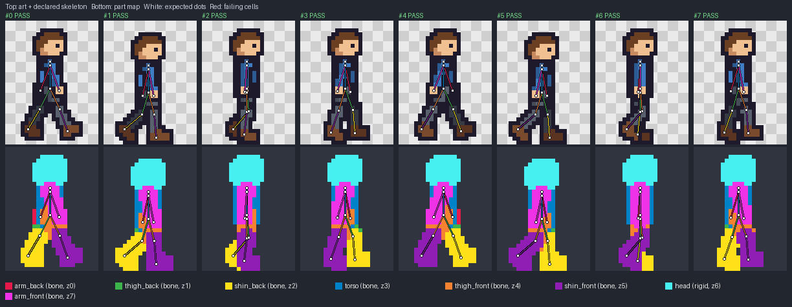
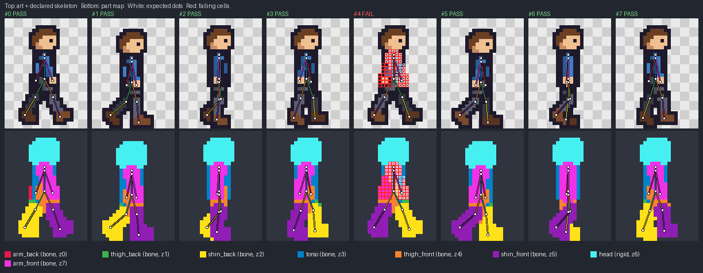

# Rigged sprite sheets

Actual `pixel_sprite.py` outputs for the bundled examples. Every sheet passed the strict profile audit before any frame or rig check ran.

## Walk cycle: 8 frames, 8 parts, 9 joints



[Sheet PNG](walk/rendered.png) (796×128, 199×32 logical cells at 4×, 24×32 cells per frame) · [Rig overlay](walk/rig_overlay.png) · [Rig GIF](walk/animations/walk.rig.gif) · [Layout overlay](walk/layout_overlay.png) · [Sprite report](walk/sprite_report.json) · [Sheet audit](walk/sheet/report.json)

The spec is [`pixelwright/examples/sprite-walk/spec.json`](../../../pixelwright/examples/sprite-walk/spec.json). Parts are listed back to front: back arm, back thigh, back shin, torso, front thigh, front shin, head and front arm. The head is `rigid` around the neck joint, so it must stay an exact copy as the body bobs; every limb and the torso are `bone` parts. The back arm is listed as `hidden` in the frames where the torso covers it completely. All 64 part-frame comparisons pass: bone parts match their moved reference at 97–100%, sizes stay within 0.85–1.12×, and no part's dots drift more than 0.67 cells from the skeleton.



## Lever: fixed base, hinged handle, rigid knob


[Sheet PNG](lever/rendered.png) · [Rig overlay](lever/rig_overlay.png) · [Rig GIF](lever/animations/switch_on.rig.gif) · [Sprite report](lever/sprite_report.json)

The base is `fixed`, the `pivot` joint is declared fixed, the handle is a `bone` from pivot to grip, and the knob is `rigid` around the grip. The handle is drawn behind the base and the knob, so its lower and upper ends are covered in every frame; z-order lets the checker accept exactly those missing dots. A 1-cell edge margin keeps the knob from touching frame borders.

## Detected failure: the arm does not follow its bone



[`walk-arm-lag/spec.json`](walk-arm-lag/spec.json) checks the **same sheet pixels** as the passing walk (identical SHA-256) but declares that the front arm swings forward in frame 4. The drawn arm still swings back, so the check fails with `PART_OFF_SKELETON` (70% of dots line up, 80% required), `PART_DRIFT` (2.10 cells across the bone) and `JOINT_OFF_PART` (the hand joint is 2.4 cells from the arm). See the [failing report](walk-arm-lag/sprite_report.json). Either the frame's arm is redrawn or the joint is corrected; the tolerances stay as declared.

## Reproduce

Run from the repository root after installing `pixelwright/requirements.txt`; use fresh output directories:

```sh
python pixelwright/scripts/pixel_sprite.py build --spec pixelwright/examples/sprite-walk/spec.json --out-dir runs/walk-build-v1
python pixelwright/scripts/pixel_sprite.py check --spec pixelwright/examples/sprite-walk/spec.json --sheet runs/walk-build-v1/rendered.png --profile pixelwright/examples/sprite-walk/profile.json --out-dir runs/walk-check-v1
python pixelwright/scripts/pixel_sprite.py check --spec docs/examples/sprites/walk-arm-lag/spec.json --sheet runs/walk-build-v1/rendered.png --profile docs/examples/sprites/walk-arm-lag/profile.json --out-dir runs/walk-arm-lag-v1
```

The lever uses the same commands with `sprite-lever`. `tools/generate_sprite_examples.py` regenerates both example specs from their skeletons; the unit tests confirm the committed specs are identical to its output. Rig overlays and GIFs are diagnostics; the sheet PNG is the audited artwork. Artistic quality, timing and weight were not assessed by these checks.
